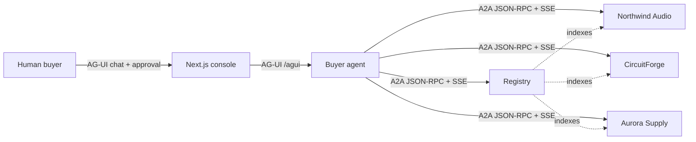

# MarketMesh

MarketMesh is a local-first, open agent-to-agent commerce exchange. A buyer agent
discovers independently operated seller agents through a registry of A2A Agent Cards,
negotiates structured offers over the A2A protocol, ranks the results deterministically,
and stops for human approval before any order task is created.

The demo scenario is a consumer-electronics team purchase: 12 Nimbus NC-700 ANC
headsets, a $3,400 ceiling, 14-day delivery, 24-month warranty, 30-day returns, and a
preference for a sustainability-certified seller. Three independent sellers compete:
Northwind Audio, CircuitForge, and Aurora Supply.

## What runs

| Service | Port | Responsibility |
| --- | --- | --- |
| Console | 3000 | CopilotKit chat, Deal Room, A2A Wire, approval and order views |
| Buyer agent | 9100 | AG-UI endpoint, LangGraph negotiation graph, approval interrupt, orders |
| Registry | 9105 | Agent Card index and discovery |
| Northwind Audio | 9201 | Independent seller A2A service |
| CircuitForge | 9202 | Independent seller A2A service |
| Aurora Supply | 9203 | Independent seller A2A service |



The UI talks to the buyer over AG-UI. The buyer and sellers use A2A 1.x JSON-RPC with
server-sent streaming. The human approval gate is outside the A2A order task: the buyer
graph pauses with a LangGraph interrupt, the console resolves it, and only then does the
buyer send an accepted offer and purchase order to the winning seller.

## Quick start

Prerequisites:

- Python 3.12
- [uv](https://docs.astral.sh/uv/)
- Node.js 20+ and npm
- Optional: Docker Compose for the containerized topology

```bash
make setup
make dev
```

Open <http://127.0.0.1:3000>, click **Run sample brief**, inspect the three seller lanes
and the A2A Wire, then approve the recommended award. `make dev` starts the registry and
sellers, seeds catalogs, registers Agent Cards, then starts the buyer and console.

Stop everything with:

```bash
make down
```

### Sample brief

> Buy 12 Nimbus NC-700 ANC headsets for our team. Budget $3,400, delivery within 14 days,
> 24-month warranty, 30-day returns. Prefer a sustainability-certified seller.

The expected ranking is CircuitForge at **$3,229.44**, Northwind Audio at **$3,372.00**,
and Aurora Supply at **$3,399.96**. CircuitForge wins on the deterministic score because
it is the lowest compliant total; the rank is computed by code, not by an LLM.

## What is mocked

MarketMesh is a production-shaped prototype with real agent communication. These
integrations are intentionally local or simulated:

- Seller catalogs and stock levels are seeded SQLite data.
- Seller identity verification is a local bearer-token directory in `.env`.
- The human approver is a demo identity; the approval receipt is an assertion.
- Fulfillment status and tracking numbers are generated by the seller order service.
- No payment processing, no money movement, and no real shipping are performed.
- There is no multi-tenant authentication or production credential exchange.

The protocol layer, LangGraph graphs, Agent Card validation, A2A task lifecycle,
structured offer validation, deterministic ranking, human interrupt, order idempotency,
and stock reservation logic are real code paths.

## Using the console

- **Brief desk** — the CopilotKit chat rail, connected to the buyer AG-UI endpoint.
  The sample button starts the same run as a typed brief.
- **Seller lanes** — each independently operated seller in the registry, with quote
  rounds, latest terms, and hard-constraint failures.
- **Offer matrix** — the comparable final offers and deterministic score.
- **Negotiation feed** — planner decisions and counter targets without invented numbers.
- **The wire** — persisted A2A frames, including outbound messages and inbound streaming
  events. JSON is redacted for authorization headers and tokens. Filter by direction or
  seller.
- **Human checkpoint** — approve or reject the award. Approve focuses by default; Escape
  does not approve. Both approval surfaces share one resume path.
- **Order desk** — approval receipt, order ID, ETA, tracking number, and simulated
  fulfillment timeline. Rejecting produces “No order was placed”.

## Adding a fourth seller

1. Copy `apps/seller_agent/seller_agent/profiles/northwind.yaml` to a new profile and
   change `seller_id`, name, prices, stock, delivery, warranty, returns, rating, and
   sustainability.
2. Add the process to `scripts/config.py` (port, token variable, database URL, profile).
3. Add the port and database URL to `.env`; add the seller ID and token to
   `BUYER_SELLER_TOKENS`.
4. Start the new seller with the same module (`python -m seller_agent`), passing
   `PROFILE_PATH`, `PUBLIC_BASE_URL`, `SELLER_TOKEN`, `DATABASE_URL`, and `PORT`.
5. Register its card with `POST /v1/sellers` using the registry admin token, or extend the
   seed list and run `make seed`.
6. Add the hostname to `ALLOWED_CARD_HOSTS` if it is not `127.0.0.1`.

The buyer re-fetches and validates every Agent Card itself; the registry is an index, not
a trust shortcut.

## Live and scripted modes

The deterministic scripted mode is the default and works without network access. It
selects planner decisions from explicit policy options, which makes the demo repeatable.

To use OpenRouter:

```bash
MARKETMESH_LLM_MODE=live
OPENROUTER_API_KEY=sk-or-...
OPENROUTER_MODEL=deepseek/deepseek-v4.1-flash
```

If live mode is requested without an `sk-or-` key, `make dev` prints a warning and falls
back to scripted mode. In live mode, the LLM proposes a strategy and rationale; code still
owns price floors, mandate checks, stock, order totals, and ranking. If a structured model
response is unusable, the graph falls back to its deterministic planner and records that
choice in the trace.

## Tests

```bash
make test      # Python unit, protocol, and integration tests
make lint      # Ruff plus TypeScript typecheck
make e2e       # starts the scripted stack and runs Playwright
```

The Python suite never calls OpenRouter. Playwright installs Chromium on first use.

## Troubleshooting

- `make dev` says the stack is already running: `make down`, then retry.
- Port already allocated: change `CONSOLE_PORT`, `BUYER_PORT`, `REGISTRY_PORT`, or the
  seller ports in `.env`; the dev runner honors them.
- Reset local databases and start fresh:
  `make down && make reset && make dev`.
- Registry dot is offline: check `http://127.0.0.1:9105/health` and
  `.dev-logs/registry.log`.
- A seller lane is missing: check its `/health` endpoint, its log in `.dev-logs/`, and
  whether its card is present at `/v1/sellers`.
- Live mode falls back to scripted: confirm the key starts with `sk-or-` and inspect
  `.dev-logs/buyer.log` and the seller logs.

## Security limits

This is a local prototype. The bearer tokens in `.env` are development credentials, not a
production secret manager. The approval receipt proves that a UI interaction occurred; it
does not prove a verified human identity. Do not expose these services to an untrusted
network or use this prototype for real purchasing, payment, or fulfillment.
