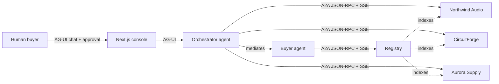

# MarketMesh

MarketMesh is a local-first, open agent-to-agent commerce exchange. A buyer agent
discovers independently operated seller agents through a registry of A2A Agent Cards,
negotiates structured offers over the A2A protocol, ranks the results deterministically,
and stops for human approval before any order task is created.

The demo scenario is a consumer-electronics team purchase: 12 Nimbus NC-700 ANC
headsets, a $3,400 ceiling, 14-day delivery, 24-month warranty, 30-day returns, and a
preference for a sustainability-certified seller. Three independent sellers compete:
Northwind Audio, CircuitForge, and Aurora Supply.

## What runs

| Service | Port | Responsibility |
| --- | --- | --- |
| Console | 3000 | CopilotKit chat, Deal Room, A2A Wire, approval and order views |
| Orchestrator agent | 9000 | AG-UI entrypoint for the console; mediates buyer/seller calls |
| Buyer agent | 9100 | LangGraph negotiation graph, approval interrupt, purchase orders |
| Registry | 9105 | Agent Card index and discovery |
| Northwind Audio | 9201 | Independent seller A2A service |
| CircuitForge | 9202 | Independent seller A2A service |
| Aurora Supply | 9203 | Independent seller A2A service |
| Verifund control plane | 9300 | Optional settlement authority; fake or PayPal Sandbox modes only |



The UI talks to the orchestrator over AG-UI. The orchestrator mediates buyer and seller
calls; the buyer and sellers use A2A 1.x JSON-RPC with server-sent streaming. The human
approval gate is outside the A2A order task: the buyer graph pauses with a LangGraph
interrupt, the console resolves it, and only then does the buyer send an accepted offer
and purchase order to the winning seller.

## Quick start

Prerequisites:

- Python 3.12
- [uv](https://docs.astral.sh/uv/)
- Node.js 20+ and npm
- Optional: Docker Compose for the containerized topology

```bash
make setup
make dev
```

Open <http://127.0.0.1:3000>, click **Run sample brief**, inspect the three seller lanes
and the A2A Wire, then approve the recommended award. `make dev` starts the registry and
sellers, seeds catalogs, registers Agent Cards, then starts the buyer, orchestrator, and
console.

Stop everything with:

```bash
make down
```

### Sample brief

> Buy 12 Nimbus NC-700 ANC headsets for our team. Budget $3,400, delivery within 14 days,
> 24-month warranty, 30-day returns. Prefer a sustainability-certified seller.

The expected ranking is CircuitForge at **$3,229.44**, Northwind Audio at **$3,372.00**,
and Aurora Supply at **$3,399.96**. CircuitForge wins on the deterministic score because
it is the lowest compliant total; the rank is computed by code, not by an LLM.

## What is mocked

MarketMesh is a production-shaped prototype with real agent communication. These
integrations are intentionally local or simulated:

- Seller catalogs and stock levels are seeded SQLite data.
- Seller identity verification is a local bearer-token directory in `.env`.
- The human approver is a demo identity; the approval receipt is an assertion.
- Fulfillment status and tracking numbers are generated by the seller order service.
- `VERIFUND_MODE=off` performs no payment processing, money movement, or real
  shipping. `VERIFUND_MODE=fake` simulates the PayPal checkout and payouts in
  SQLite. `VERIFUND_MODE=sandbox` moves PayPal Sandbox funds only; no live money
  is involved.
- There is no multi-tenant authentication or production credential exchange.

The protocol layer, LangGraph graphs, Agent Card validation, A2A task lifecycle,
structured offer validation, deterministic ranking, human interrupt, order idempotency,
and stock reservation logic are real code paths.

## Using the console

Routes: `/` (home + live run), `/runs`, `/runs/[runId]`, `/sellers`, `/settings`, `/help`.

- **Brief desk** — the CopilotKit chat rail, connected to the buyer AG-UI endpoint.
  The sample button starts the same run as a typed brief.
- **Seller lanes** — each independently operated seller in the registry, with quote
  rounds, latest terms, and hard-constraint failures.
- **Offer matrix** — the comparable final offers and deterministic score.
- **Negotiation feed** — planner decisions and counter targets without invented numbers.
- **The wire** — persisted A2A frames, including outbound messages and inbound streaming
  events. JSON is redacted for authorization headers and tokens. Filter by direction or
  seller.
- **Human checkpoint** — approve or reject the award. Approve focuses by default; Escape
  does not approve. Both approval surfaces share one resume path.
- **Order desk** — approval receipt, order ID, ETA, tracking number, and simulated
  fulfillment timeline. Rejecting produces “No order was placed”.

Runs are persisted by the buyer agent; `/runs` lists them and `/runs/[runId]` replays
a run (metadata + trace) even after the browser thread is gone.

For the complete end-to-end flow (from "Ask agent to negotiate" through seller payout and
receipt), see [`docs/workflow.md`](docs/workflow.md).

### Order evidence (seller workspace)

- Evidence is addressed by **`requirement_id`** (legacy `kind` is rejected);
  the catalog (design spec §3.1.1: `product_photos`, `serial`, `hardware`,
  `warranty`, `shipping`, `delivery_confirmation`, `invoice`) is authored
  by the buyer agent, copied into agreement terms, and projected back to
  the seller as `SellerProjection.requirements[]`.
- Uploads collect `requirement_id` and optional `captured_at`; file
  uploads honor `accepted_formats` (`image/jpeg/png/webp`, video
  `mp4/quicktime/webm`, `text/csv`, `text/plain`, `application/pdf/json`),
  and `source=reference` requirements take a tracking number / URL
  (`reference` + `reference_type=tracking|url`) instead of a file.
- Submissions accumulate per attempt; a seller declaration closes an
  attempt, and a later submission starts the next. Dispute
  counter-evidence is stored with `purpose=dispute` and never feeds
  verification or rollup.
- The single seller status vocabulary lives in
  `apps/console/lib/seller-status.ts` (state -> label map, spec §3.9.4);
  there is deliberately no `REJECTED` evidence badge.

### Verifund settlement (always on)

`VERIFUND_MODE` selects the settlement behavior (default: `sandbox`):

| Mode | Behavior |
| --- | --- |
| `off` | Escape hatch: disables settlement entirely (offline dev). No control plane, no settlement fields, no extra processes. |
| `fake` | Local control plane on port 9300 and registered Verifund A2A agent on port 9301 with fake checkout and payouts. The chat-led agreement → funding → evidence → release → receipt lifecycle runs without network access. |
| `sandbox` (default) | Real PayPal Sandbox Orders, Capture, Payouts, and webhooks. Manual testing only; the control plane refuses the live PayPal host. |

When enabled, the registered Verifund A2A agent works with the CopilotKit
orchestrator in chat. The user reviews the control-plane agreement and approves
funding in a HITL card, completes payer approval on PayPal's hosted page, then
reviews the deterministic evidence result and separately approves payout
release in chat. The Transaction Room shows the synchronized funding, evidence,
verification, payout, cancellation, and signed receipt details. Fake mode starts
the Verifund agent on port 9301; `off` starts no settlement services.

```bash
make verifund-smoke      # headless fake lifecycle; temporary control plane
make verifund-demo       # fake stack with the console
make verifund-e2e        # Playwright fake-mode acceptance test
make verifund-preflight  # PayPal Sandbox configuration checks
VERIFUND_SANDBOX_SMOKE=1 make verifund-sandbox-smoke  # gated manual sandbox run
```

Data lives in `data/verifund.db` and `data/evidence/`. `make reset` removes both.
See [`docs/verifund-paypal-sandbox.md`](docs/verifund-paypal-sandbox.md) for the
account, webhook, tunnel, and payout setup, and
[`docs/superpowers/specs/2026-10-27-verifund-control-plane-design.md`](docs/superpowers/specs/2026-10-27-verifund-control-plane-design.md)
for the design.

### Seller fulfillment workspace

The seller-facing workspace lives under `/seller/*` and is fully
documented in [`docs/seller-fulfillment-workspace.md`](docs/seller-fulfillment-workspace.md):
invitation exchange (`POST /ops/transactions/{id}/issue-invitation` →
`/fulfillment/access/{token}`, token stored in an HttpOnly cookie),
scoped read endpoints, requirement-addressed uploads, and the single
status vocabulary. `docs/console.md` covers the console's buyer routes.

## Conversation history

Durable, per-user conversation history is built on CopilotKit Intelligence and a
durable ADK session store:

- Set `CPK_INTELLIGENCE_API_KEY` (and optional `INTELLIGENCE_API_URL` /
  `INTELLIGENCE_GATEWAY_WS_URL`) before building the console. Without a key, the
  history panel is hidden and the runtime falls back to the in-memory agent runner.
- Create the `demo-user` user in the Intelligence project; `identifyUser` returns
  `{ id: "demo-user", name: "Demo User" }`.
- The orchestrator persists ADK sessions in `./data/orchestrator_sessions.db`
  (`ORCHESTRATOR_SESSION_DB_URL`). Ensure the directory is writable and persisted
  across restarts.
- Buyer and Verifund agents already use SQLite checkpoints (`checkpoint_path`).
- The A2A middleware patch in `apps/console/patches/` is applied automatically
  via pnpm, so `contextId` is propagated from the CopilotKit thread id.
- One conversation thread maps to one procurement run. Starting a new run mints a
  new thread.

### Tests

- `cd apps/console && pnpm run test` — Vitest unit/component tests.
- `cd apps/console && pnpm run typecheck` — TypeScript check.
- `make e2e` — Playwright (starts the scripted stack).
- `make verifund-smoke` — headless fake settlement lifecycle.
- `make verifund-e2e` — Playwright fake settlement flow.

## Adding a fourth seller

1. Copy `apps/seller_agent/seller_agent/profiles/northwind.yaml` to a new profile and
   change `seller_id`, name, prices, stock, delivery, warranty, returns, rating, and
   sustainability.
2. Add the process to `scripts/config.py` (port, token variable, database URL, profile).
3. Add the port and database URL to `.env`; add the seller ID and token to
   `BUYER_SELLER_TOKENS`.
4. Start the new seller with the same module (`python -m seller_agent`), passing
   `PROFILE_PATH`, `PUBLIC_BASE_URL`, `SELLER_TOKEN`, `DATABASE_URL`, and `PORT`.
5. Register its card with `POST /v1/sellers` using the registry admin token, or extend the
   seed list and run `make seed`.
6. Add the hostname to `ALLOWED_CARD_HOSTS` if it is not `127.0.0.1`, and add its
   exact card URL to `ALLOWED_CARD_URLS` unless it uses a platform-issued
   `/{seller_id}/a2a` path.

The buyer re-fetches and validates every Agent Card itself; the registry is an index, not
a trust shortcut.

## Live and scripted modes

The deterministic scripted mode works without network access and is used automatically when
no Nebius key is configured. It selects planner decisions from explicit policy options,
which makes the demo repeatable. (`.env.example` requests live mode, but `make dev` falls
back to scripted mode if `NEBIUS_API_KEY` is absent.)

To use Nebius token factory:

```bash
MARKETMESH_LLM_MODE=live
NEBIUS_API_KEY=<your-nebius-key>
NEBIUS_BASE_URL=https://api.tokenfactory.us-central1.nebius.com/v1/
NEBIUS_MODEL=deepseek-ai/DeepSeek-V4-Flash-0731
```

If live mode is requested without a Nebius key, `make dev` prints a warning and falls
back to scripted mode. In live mode, the LLM proposes a strategy and rationale; code still
owns price floors, mandate checks, stock, order totals, and ranking. If a structured model
response is unusable, the graph falls back to its deterministic planner and records that
choice in the trace.

## Tests

```bash
make test      # Python unit, protocol, and integration tests
make lint      # Ruff plus TypeScript typecheck
make e2e       # starts the scripted stack and runs Playwright
```

The Python suite never calls Nebius. Playwright installs Chromium on first use.

## Troubleshooting

- `make dev` says the stack is already running: `make down`, then retry.
- Port already allocated: change `CONSOLE_PORT`, `BUYER_PORT`, `REGISTRY_PORT`, or the
  seller ports in `.env`; the dev runner honors them.
- Reset local databases and start fresh:
  `make down && make reset && make dev`.
- Registry dot is offline: check `http://127.0.0.1:9105/health` and
  `.dev-logs/registry.log`.
- A seller lane is missing: check its `/health` endpoint, its log in `.dev-logs/`, and
  whether its card is present at `/v1/sellers`.
- Live mode falls back to scripted: confirm the Nebius key is set and inspect
  `.dev-logs/buyer.log` and the seller logs.
- Verifund control plane will not start: inspect `.dev-logs/verifund.log`; sandbox
  mode refuses default secrets, a missing webhook ID, a non-HTTPS public URL, and
  the live PayPal host.
- Fake checkout never reaches `FUNDED`: click **Refresh state** in the Transaction
  Room; the fake webhook is a UI convenience, not the source of truth.
- Sandbox capture or payout is missing: run `make verifund-preflight`, confirm the
  tunnel still points at port 9300, and check that the platform account has sandbox
  balance.
- Payout lands in `REVIEW_REQUIRED`: open the PayPal sandbox activity for the batch;
  funding mismatches, ledger inconsistencies, and late captures are resolved in
  PayPal, not with a Verifund override.

## Security limits

This is a local prototype. The bearer tokens in `.env` are development credentials,
not a production secret manager. The approval receipt proves that a UI interaction
occurred; it does not prove a verified human identity. Verifund is Sandbox-only and
must never be pointed at live PayPal. Do not expose these services to an untrusted
network or use this prototype for real purchasing, payment, or fulfillment.
