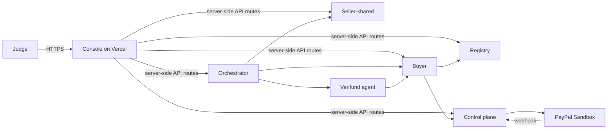

# Deployment Guide: Render Backend + Vercel Console

**Document type:** How-to guide
**Audience:** The team deploying the MarketMesh / Verifund demo
**Goal:** A working hosted demo with the backend on Render and the console on Vercel.

This guide reflects the deployment architecture selected for the current demo window:

| Decision | Choice |
| --- | --- |
| Backend scope | Full six-service topology |
| Settlement mode | `VERIFUND_MODE=sandbox` (real PayPal Sandbox) |
| Console platform | Vercel |
| Console → backend | Public Render URLs (no private networking) |
| Database | Render Postgres (free tier) |
| LLM mode | `live` (Nebius) |
| Auth | Clerk (test keys) |
| Initial data | Sellers onboarded through the console UI |

> **Warning:** This path requires a PostgreSQL migration (the code is SQLite-only) and accepts free-tier limitations. Read [Before you start](#before-you-start--three-blockers) before committing. A zero-code-change alternative is listed in [Alternative topology](#alternative-topology-paid-render--sqlite).

---

## Prerequisites

- A Render account with the repo connected.
- A Vercel account.
- A PayPal Developer account with sandbox accounts (platform, buyer, and one per seller).
- A Clerk account (test instance is acceptable for this demo).
- A Nebius API key.
- The repo checked out locally for the PostgreSQL migration and Docker fixes.

---

## Architecture

| Layer | Service | Render name | Port | Public URL |
| --- | --- | --- | --- | --- |
| Backend | orchestrator | `orchestrator` | 9000 | `https://orchestrator.onrender.com` |
| Backend | buyer | `buyer` | 9100 | `https://buyer.onrender.com` |
| Backend | registry | `registry` | 9105 | `https://registry.onrender.com` |
| Backend | seller-shared | `seller-shared` | 9200 | `https://seller-shared.onrender.com` |
| Backend | verifund control plane | `control-plane` | 9300 | `https://control-plane.onrender.com` |
| Backend | verifund agent | `verifund-agent` | 9301 | `https://verifund-agent.onrender.com` |
| Database | Render Postgres | `marketmesh` | 5432 | internal |
| Frontend | console | Vercel project | — | `https://<project>.vercel.app` |

All six backend services are **public web services**. Free-tier services cannot receive private network traffic, and the Vercel console must reach them over public HTTPS. They communicate with each other via their `*.onrender.com` URLs.



---

## Before you start — three blockers

### 1. The code is SQLite-only; Postgres is not implemented

`pyproject.toml` has no PostgreSQL driver, and the codebase contains SQLite-specific logic:

- `configure_sqlite` (WAL mode, foreign keys).
- `_ensure_columns` using `PRAGMA table_info`.
- `langgraph-checkpoint-sqlite` for buyer/seller/verifund-agent checkpoints.
- The ADK session store (`ORCHESTRATOR_SESSION_DB_URL`).

The Neon design and implementation plan exist under `docs/superpowers/`, but they were never implemented. Switching to Render Postgres is a **multi-day migration**, not a connection-string change. See [Step 1](#step-1--migrate-to-postgres).

### 2. Free-tier limitations

- **Cold starts:** free services spin down after 15 minutes without traffic and take about one minute to spin up. This breaks long-lived SSE streams.
- **750 free instance hours per month:** six always-on services consume roughly 4,380 hours per month, exhausting the quota in about five days.
- **No persistent disks:** local SQLite files and uploaded evidence are lost on every redeploy, restart, and spin-down.
- **No shell or one-off jobs:** seeding cannot be a manual Render Shell run.
- **No private networking:** free services cannot receive private traffic, so every service must be public.
- **No health checks on free tier:** Render restarts crashed services, but there is no health-check-driven restart or zero-downtime deploy.

### 3. Evidence and checkpoints are ephemeral

The control plane writes evidence files to `VERIFUND_EVIDENCE_DIR`, and the buyer/seller/verifund-agent keep LangGraph checkpoints on local disk. With no persistent disk:

- Postgres can hold the graph checkpoints (via `langgraph-checkpoint-postgres`), but **not** the evidence files.
- Evidence files need object storage (S3, Cloudflare R2) or a paid persistent disk.

---

## Step 1 — Migrate to Postgres

1. Add drivers to `pyproject.toml`:
   - `psycopg[binary,pool]>=3.2,<4`
   - `langgraph-checkpoint-postgres`
   Run `uv lock` afterwards.
2. Replace every `sqlite+aiosqlite:///` URL with `postgresql+psycopg://`. The affected variables are:
   - `BUYER_DATABASE_URL`
   - `REGISTRY_DATABASE_URL`
   - `SELLER_SHARED_DB_URL`
   - `VERIFUND_DATABASE_URL`
   - `VERIFUND_AGENT_DATABASE_URL`
   - `ORCHESTRATOR_SESSION_DB_URL`
3. Replace SQLite-specific code:
   - `configure_sqlite` → PostgreSQL engine configuration (no WAL/PRAGMA).
   - `_ensure_columns` (`PRAGMA table_info`) → query `information_schema.columns`.
   - `langgraph-checkpoint-sqlite` → `langgraph-checkpoint-postgres` for the buyer, seller, and verifund-agent checkpoints.
   - ADK session store → PostgreSQL-backed store.
4. Create one database per service inside the single Render Postgres instance: `buyer`, `registry`, `sellers`, `verifund`, `verifund_agent`, `orchestrator`. Render's free tier allows only one Postgres instance, but that instance can host multiple databases.
5. Test locally with Docker Compose and a PostgreSQL service before deploying.

---

## Step 2 — Deploy the backend on Render

### 2.1 Docker build fixes

- `Dockerfile.python` copies `packages`, `apps/*`, and `scripts`, but **not** `docs/templates`. That is fine when sellers are onboarded through the UI, but `make seed-demo` will fail inside the container.
- `apps/console/Dockerfile` is broken: it runs `npm ci` and copies `package-lock.json`, but the repo only contains `pnpm-lock.yaml`. This does not affect Vercel, but fix it if the console is ever moved to Render.

### 2.2 Render Blueprint

Create `render.yaml` at the repository root:

```yaml
services:
  - type: web
    runtime: docker
    name: orchestrator
    plan: free
    region: oregon
    dockerfilePath: ./Dockerfile.python
    dockerCommand: python -m orchestrator_agent
    healthCheckPath: /health
    envVars:
      - fromGroup: shared
      - fromGroup: orchestrator

  - type: web
    runtime: docker
    name: buyer
    plan: free
    region: oregon
    dockerfilePath: ./Dockerfile.python
    dockerCommand: python -m buyer_agent
    healthCheckPath: /health
    envVars:
      - fromGroup: shared
      - fromGroup: buyer

  - type: web
    runtime: docker
    name: registry
    plan: free
    region: oregon
    dockerfilePath: ./Dockerfile.python
    dockerCommand: python -m registry
    healthCheckPath: /health
    envVars:
      - fromGroup: shared
      - fromGroup: registry

  - type: web
    runtime: docker
    name: seller-shared
    plan: free
    region: oregon
    dockerfilePath: ./Dockerfile.python
    dockerCommand: python -m seller_agent
    healthCheckPath: /health
    envVars:
      - fromGroup: shared
      - fromGroup: seller

  - type: web
    runtime: docker
    name: control-plane
    plan: free
    region: oregon
    dockerfilePath: ./Dockerfile.python
    dockerCommand: python -m verifund_control_plane
    healthCheckPath: /health
    envVars:
      - fromGroup: shared
      - fromGroup: control-plane

  - type: web
    runtime: docker
    name: verifund-agent
    plan: free
    region: oregon
    dockerfilePath: ./Dockerfile.python
    dockerCommand: python -m verifund_agent
    healthCheckPath: /ready
    envVars:
      - fromGroup: shared
      - fromGroup: verifund-agent

databases:
  - name: marketmesh
    plan: free
    region: oregon
    databaseName: marketmesh
    user: marketmesh

envVarGroups:
  - name: shared
    envVars:
      - key: HOST
        value: 0.0.0.0
      - key: MARKETMESH_LLM_MODE
        value: live
      - key: NEBIUS_API_KEY
        sync: false
      - key: NEBIUS_BASE_URL
        value: https://api.tokenfactory.us-central1.nebius.com/v1/
      - key: NEBIUS_MODEL
        value: deepseek-ai/DeepSeek-V4-Flash-0731
      - key: VERIFUND_MODE
        value: sandbox

  - name: orchestrator
    envVars:
      - key: PORT
        value: "9000"
      - key: ORCHESTRATOR_URL
        value: https://orchestrator.onrender.com
      - key: ORCHESTRATOR_AGUI_URL
        value: https://orchestrator.onrender.com
      - key: BUYER_A2A_URL
        value: https://buyer.onrender.com
      - key: SELLER_SHARED_URL
        value: https://seller-shared.onrender.com
      - key: BUYER_INTERNAL_URL
        value: https://buyer.onrender.com
      - key: BUYER_INTERNAL_TOKEN
        sync: false
      - key: VERIFUND_AGENT_URL
        value: https://verifund-agent.onrender.com
      - key: VERIFUND_AGENT_CARD_URL
        value: https://verifund-agent.onrender.com/.well-known/agent-card.json
      - key: VERIFUND_AGENT_A2A_TOKEN
        sync: false
      - key: COPILOTKIT_AGENT_MODEL
        value: openai:deepseek-ai/DeepSeek-V4-Flash-0731
      - key: OPENAI_BASE_URL
        value: https://api.tokenfactory.us-central1.nebius.com/v1/
      - key: OPENAI_API_KEY
        sync: false
      - key: ORCHESTRATOR_SESSION_DB_URL
        sync: false

  - name: buyer
    envVars:
      - key: PORT
        value: "9100"
      - key: REGISTRY_URL
        value: https://registry.onrender.com
      - key: BUYER_DATABASE_URL
        sync: false
      - key: BUYER_CHECKPOINT_PATH
        sync: false
      - key: BUYER_CONSOLE_API_TOKEN
        sync: false
      - key: BUYER_REGISTRY_POLL_SECONDS
        value: "30"
      - key: SELLER_INTERNAL_TOKEN
        sync: false
      - key: ALLOWED_CARD_HOSTS
        value: '["orchestrator.onrender.com","buyer.onrender.com","seller-shared.onrender.com","control-plane.onrender.com","verifund-agent.onrender.com"]'
      - key: VERIFUND_URL
        value: https://control-plane.onrender.com
      - key: VERIFUND_OPS_TOKEN
        sync: false
      - key: BUYER_INTERNAL_TOKEN
        sync: false
      - key: VERIFUND_CONTROL_PLANE_URL
        value: https://control-plane.onrender.com
      - key: VERIFUND_AGENT_INTERNAL_TOKEN
        sync: false

  - name: registry
    envVars:
      - key: PORT
        value: "9105"
      - key: REGISTRY_DATABASE_URL
        sync: false
      - key: REGISTRY_ADMIN_TOKEN
        sync: false
      - key: ALLOWED_CARD_HOSTS
        value: '["orchestrator.onrender.com","buyer.onrender.com","seller-shared.onrender.com","control-plane.onrender.com","verifund-agent.onrender.com"]'
      - key: ALLOWED_CARD_URLS
        value: "[]"

  - name: seller
    envVars:
      - key: PORT
        value: "9200"
      - key: SELLER_CONFIG_SOURCE
        value: shared
      - key: SELLER_SHARED_DB_URL
        sync: false
      - key: SELLER_INTERNAL_TOKEN
        sync: false
      - key: PUBLIC_BASE_URL
        value: https://seller-shared.onrender.com
      - key: VERIFUND_URL
        value: https://control-plane.onrender.com
      - key: SELLER_CHECKPOINT_PATH
        sync: false

  - name: control-plane
    envVars:
      - key: PORT
        value: "9300"
      - key: VERIFUND_PUBLIC_BASE_URL
        value: https://control-plane.onrender.com
      - key: VERIFUND_CONSOLE_BASE_URL
        value: https://<project>.vercel.app
      - key: VERIFUND_ALLOW_PUBLIC_BIND
        value: "1"
      - key: VERIFUND_OPS_TOKEN
        sync: false
      - key: VERIFUND_SELLER_TOKEN_SECRET
        sync: false
      - key: VERIFUND_LINK_SECRET
        sync: false
      - key: VERIFUND_RECEIPT_KEYS
        sync: false
      - key: VERIFUND_RECEIPT_ACTIVE_KID
        sync: false
      - key: VERIFUND_DATABASE_URL
        sync: false
      - key: VERIFUND_EVIDENCE_DIR
        value: /app/data/evidence
      - key: VERIFUND_TENANCY_ENABLED
        value: "true"
      - key: PAYPAL_ENV
        value: sandbox
      - key: PAYPAL_API_BASE
        value: https://api-m.sandbox.paypal.com
      - key: PAYPAL_CLIENT_ID
        sync: false
      - key: PAYPAL_CLIENT_SECRET
        sync: false
      - key: PAYPAL_WEBHOOK_ID
        sync: false
      - key: PAYPAL_PLATFORM_EMAIL
        sync: false
      - key: PAYPAL_BUYER_EMAIL
        sync: false
      - key: VERIFUND_SELLER_PAYOUT_EMAILS
        sync: false
      - key: CLERK_SECRET_KEY
        sync: false
      - key: CLERK_JWT_KEY
        sync: false
      - key: CLERK_WEBHOOK_SIGNING_SECRET
        sync: false

  - name: verifund-agent
    envVars:
      - key: PORT
        value: "9301"
      - key: VERIFUND_AGENT_URL
        value: https://verifund-agent.onrender.com
      - key: VERIFUND_AGENT_A2A_TOKEN
        sync: false
      - key: VERIFUND_AGENT_INTERNAL_TOKEN
        sync: false
      - key: VERIFUND_AGENT_DATABASE_URL
        sync: false
      - key: VERIFUND_AGENT_CHECKPOINT_PATH
        sync: false
      - key: BUYER_INTERNAL_URL
        value: https://buyer.onrender.com
```

### 2.3 Notes on the Blueprint

- `PORT` is set per service. Render routes public traffic to the port defined by `PORT`; the default is `10000`, so overriding it is required.
- `sync: false` means Render prompts for the value when the Blueprint is first applied. Use it for every secret.
- The `*.onrender.com` subdomains assume the service names are available. Verify the exact URLs in the Render dashboard after the first deploy and correct any env vars that reference them.
- `ALLOWED_CARD_HOSTS` and `ALLOWED_CARD_URLS` control which Agent Card URLs the buyer and registry will fetch. With dynamic onboarding, `ALLOWED_CARD_URLS` can stay empty and the shared host is allowed.
- Free-tier services cannot use `healthCheckPath` for restart-driven recovery; Render still restarts crashed processes.

---

## Step 3 — Deploy the console on Vercel

1. Import the repository into Vercel and set the **Root Directory** to `apps/console`. Vercel detects `pnpm-lock.yaml` and runs `pnpm install`.
2. Build command: `pnpm run build`. The Next.js `output: "standalone"` setting is harmless on Vercel.
3. Set the environment variables.

   **Server-side:**

   | Variable | Value |
   | --- | --- |
   | `BUYER_AGUI_URL` | `https://buyer.onrender.com/agui` |
   | `BUYER_API_URL` | `https://buyer.onrender.com` |
   | `BUYER_A2A_URL` | `https://buyer.onrender.com` |
   | `BUYER_CONSOLE_API_TOKEN` | shared secret |
   | `BUYER_INTERNAL_TOKEN` | shared secret |
   | `ORCHESTRATOR_AGUI_URL` | `https://orchestrator.onrender.com` |
   | `ORCHESTRATOR_URL` | `https://orchestrator.onrender.com` |
   | `REGISTRY_URL` | `https://registry.onrender.com` |
   | `SELLER_SHARED_URL` | `https://seller-shared.onrender.com` |
   | `VERIFUND_CONTROL_PLANE_URL` | `https://control-plane.onrender.com` |
   | `VERIFUND_OPS_TOKEN` | shared secret |
   | `PAYPAL_CLIENT_SECRET` | PayPal sandbox secret |
   | `CPK_INTELLIGENCE_API_KEY` | optional |

   **Client-side (`NEXT_PUBLIC_*`):**

   | Variable | Value |
   | --- | --- |
   | `NEXT_PUBLIC_CLERK_PUBLISHABLE_KEY` | Clerk publishable key |
   | `NEXT_PUBLIC_MARKETMESH_LLM_MODE` | `live` |
   | `NEXT_PUBLIC_VERIFUND_MODE` | `sandbox` |
   | `NEXT_PUBLIC_PAYPAL_CLIENT_ID` | must equal `PAYPAL_CLIENT_ID` |
   | `NEXT_PUBLIC_PAYPAL_ENVIRONMENT` | `sandbox` |
   | `NEXT_PUBLIC_COPILOTKIT_THREADS_ENABLED` | `true` only if a CopilotKit Intelligence key is set |

4. Clerk: add the Vercel domain to Clerk's allowed origins. The bare `clerkMiddleware()` requires the keys at runtime.
5. Function duration: `/api/runs/[runId]/stream` and `/api/copilotkit` stream SSE. Vercel's fluid compute defaults to 300 seconds (Pro: 800 seconds, beta: 1800 seconds), which is sufficient. Set `maxDuration` on those routes if a run takes longer.
6. **Caveat:** `apps/console/app/api/copilotkit/[[...slug]]/route.ts` hardcodes the four demo seller URLs (`northwind-audio`, `circuitforge`, `aurora-supply`, `summit-tech`). If sellers are onboarded with different IDs, update that list or confirm the orchestrator's `mediate_seller_call` path does not depend on it.

---

## Step 4 — Configure PayPal Sandbox

1. Create a PayPal Developer account and a sandbox app. Record `PAYPAL_CLIENT_ID` and `PAYPAL_CLIENT_SECRET`.
2. Create a sandbox webhook pointing at `https://control-plane.onrender.com/webhooks/paypal`. Copy the webhook ID into `PAYPAL_WEBHOOK_ID`.
3. Set `VERIFUND_PUBLIC_BASE_URL=https://control-plane.onrender.com`. Sandbox mode requires HTTPS; Render provides it.
4. Payer return and cancel URLs are built from `public_base_url` (`/return/{token}` and `/cancel/{token}`) and redirect to the console's `/runs/{runId}`.
5. Create separate sandbox accounts for the platform, the buyer, and each seller. Put the seller emails in `VERIFUND_SELLER_PAYOUT_EMAILS`; the values must be unique.
6. The control plane's sandbox guard refuses default secrets, a missing webhook ID, a non-HTTPS public URL, and the live PayPal host. All of the above must be real values.

See `docs/verifund-paypal-sandbox.md` for the full account, webhook, tunnel, and payout setup.

---

## Step 5 — Configure Clerk

1. Create a Clerk app. This guide uses test keys; see the caveat below.
2. Console: set `NEXT_PUBLIC_CLERK_PUBLISHABLE_KEY` and `CLERK_SECRET_KEY`.
3. Control plane: set `CLERK_SECRET_KEY`, `CLERK_JWT_KEY`, and `CLERK_WEBHOOK_SIGNING_SECRET`.
4. Point the Clerk webhook at `https://control-plane.onrender.com/v1/webhooks/clerk` so tenancy users and organizations sync.
5. Configure the Vercel domain in Clerk.

> **Caveat:** Clerk test keys are intended for development and are rate-limited. For a public demo, production keys are safer. The control plane's real tenancy path expects them.

---

## Step 6 — Onboard the four sellers through the UI

The control plane bootstraps the **buyer agent** automatically on startup (`seed_demo_agents`). Sellers are created dynamically through the console:

1. Sign in to the console with Clerk and create a seller organization at `/seller/onboarding`.
2. Complete the wizard in order:
   1. Profile
   2. Create agent
   3. Config
   4. Policies
   5. Import catalog — paste the YAML from `docs/templates/northwind.yaml`, `circuitforge.yaml`, `aurora.yaml`, or `summit-tech.yaml`
   6. Test
   7. Verification (payout email)
   8. Activate
3. On activation, the control plane publishes the Agent Card to the registry. The buyer polls the registry every 30 seconds and discovers the seller.
4. Repeat for all four sellers. This reproduces the demo's deterministic ranking.

---

## Step 7 — Verify

1. Health:
   - `GET https://<service>.onrender.com/health` for orchestrator, buyer, registry, seller-shared, and control-plane.
   - `GET https://verifund-agent.onrender.com/ready` for the Verifund agent.
2. Registry: `GET https://registry.onrender.com/v1/sellers` lists four registered Agent Cards.
3. Console: load the Vercel URL, sign in, click **Run sample brief**, inspect the seller lanes and the A2A Wire, then approve the award.
4. Settlement: watch the Transaction Room for the Sandbox funding → evidence → payout lifecycle.
5. PayPal: check the sandbox activity and the control plane's webhook event records.

---

## Troubleshooting

| Symptom | Cause | Fix |
| --- | --- | --- |
| A service is unreachable after 15 minutes | Free-tier spin-down | Make a request to trigger spin-up; accept ~1 minute, or use a pinger (burns free hours) |
| Free services suspended | 750 monthly free instance hours exhausted | Stop services when not in use, or upgrade to paid |
| Control plane refuses to start | Sandbox guard | Confirm HTTPS `VERIFUND_PUBLIC_BASE_URL`, webhook ID, strong secrets, and sandbox PayPal host |
| Seller lane missing | Seller not activated or card not registered | Re-run the onboarding wizard; check `/v1/sellers` |
| Evidence disappears after redeploy | No persistent disk on free tier | Move evidence to object storage, or upgrade to a paid disk |
| Console cannot reach a backend service | Wrong env var or service URL | Verify the Render public URLs in the Vercel env vars |
| Checkout never reaches `FUNDED` | PayPal webhook not arriving | Confirm the webhook URL and that the control plane is public |
| Chat does not show a new seller | Console middleware hardcodes the four demo sellers | Update the seller list in the CopilotKit route |

---

## Alternative topology: paid Render + SQLite

The chosen path is the cheapest but also the most fragile: a multi-day Postgres migration, ephemeral evidence and checkpoints, cold starts, a roughly five-day monthly runtime budget, and all services public.

If the hackathon window is short and Render credits are available, the zero-code-change alternative is strongly preferable:

> **Paid Render tier (0.5c-512mb or 1c-2g) + SQLite on persistent disks + the console on Render.**

Benefits:

- No PostgreSQL migration.
- Warm services (no cold starts).
- Private networking between services.
- Shell and one-off job support for seeding.
- The evidence directory persists on a disk.

Trade-off: the console moves off Vercel/Netlify onto Render. The repository's own `docs/sponsor-integrations.md` §6 specifies this all-on-Render topology.

---

## Related documentation

- `docs/sponsor-integrations.md` §6 — the original Render topology recommendation.
- `docs/verifund-paypal-sandbox.md` — PayPal Sandbox account, webhook, tunnel, and payout setup.
- `docs/superpowers/specs/2026-11-06-verifund-neon-postgres-design.md` — PostgreSQL design (unimplemented).
- `docs/superpowers/plans/2026-11-06-verifund-neon-foundation-control-plane.md` — PostgreSQL migration plan.
- `docs/superpowers/specs/2026-11-08-dynamic-seller-onboarding-design.md` — dynamic seller onboarding design.
- `docs/runbook.md` — local operations and the legacy `make seed-demo` flow.
