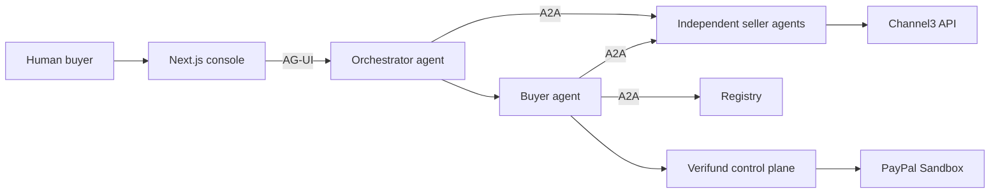
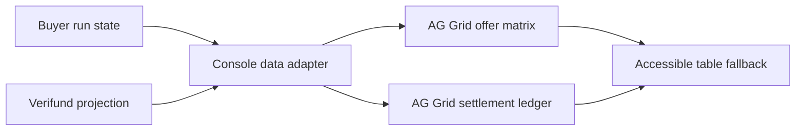
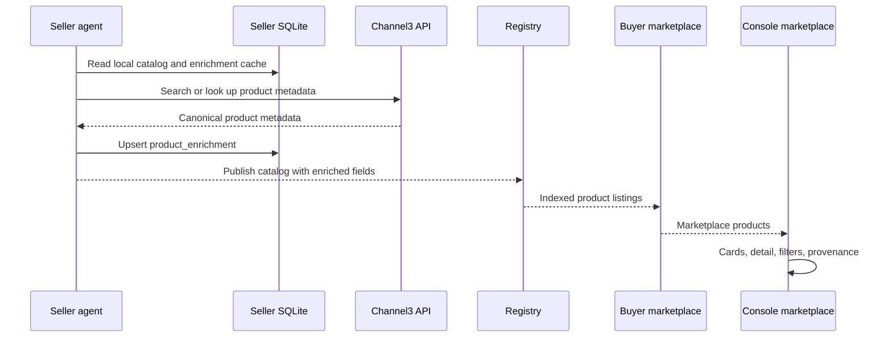
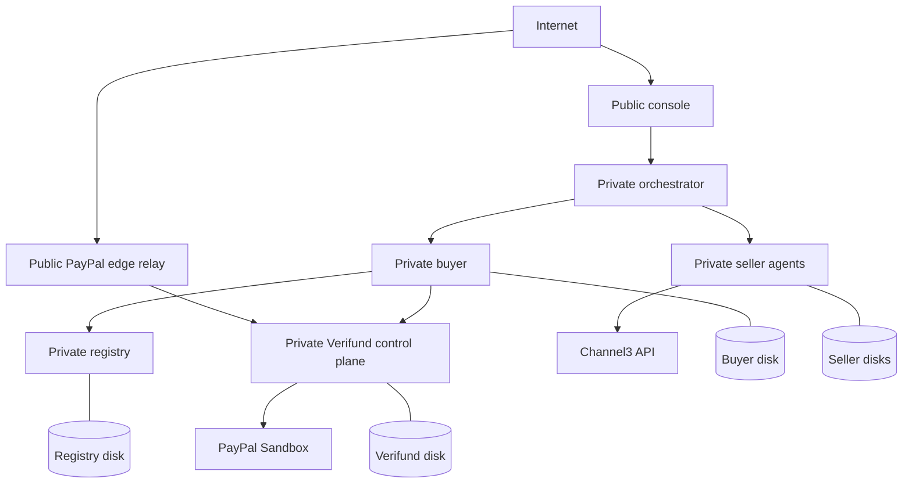

# Sponsor Integrations for MarketMesh (Verifund A2A)

**Status:** Architecture decision document  
**Date:** 2026-10-28  
**Audience:** Implementation team and hackathon judges  
**Scope:** AG Grid, Channel3, and Render

---

## 1. Executive summary

MarketMesh is not a generic shopping assistant. It is an agent-to-agent commerce exchange with four properties that must survive every sponsor integration:

1. Independent seller agents negotiate structured offers over A2A.
2. Code — not an LLM — computes eligibility, scores, and the winning award.
3. A human approves the award before any order task is created.
4. Verifund settles through PayPal Sandbox against evidence, with a human release step.

The three sponsor integrations recommended here reinforce those properties rather than bypassing them.

| Integration | What it adds | Why it fits | Priority |
| --- | --- | --- | --- |
| **AG Grid** | Offer matrix and settlement ledger | MarketMesh is a comparison and audit product; both surfaces are naturally tabular | **P0** |
| **Render** | Hosted full-Sandbox topology | The submission needs a functional demo; Render makes the eight-service system inspectable without local setup | **P0** |
| **Channel3** | Seller-side catalog enrichment | Independent sellers get rich, real product metadata without surrendering control of price or terms | **P1** |

**Recommended order:** AG Grid → Render → Channel3.

AG Grid and Render improve the core submission immediately. Channel3 is the strongest narrative differentiator, but it touches seller schemas, marketplace contracts, and the demo product, so it should follow once the comparison and hosted-demo surfaces are stable.

### What this document decides

- AG Grid Community will replace the offer matrix and add a read-only settlement ledger, with an accessible table fallback.
- Channel3 enrichment will run seller-side, be stored in a seller-owned SQLite table, and appear as attributed metadata on marketplace cards and detail views.
- Channel3 metadata will power marketplace discovery and filtering only. It will not enter the deterministic ranking.
- The fictional Nimbus NC-700 will be replaced by the Sony WH-1000XM5 across the demo, profiles, fixtures, and documentation.
- Render will host the full Sandbox topology behind a gated demo experience, with a labeled fake-mode fallback if PayPal Sandbox is unhealthy.
- Elastic, KERNEL, Astropods, Zapier, Postman, Bryntum, and APIMatic are deferred. They are not part of this cycle.

---

## 2. MarketMesh in one page

MarketMesh is a local-first, production-shaped prototype. The console talks to an orchestrator over AG-UI; the orchestrator mediates buyer and seller calls; the buyer and independently operated sellers speak A2A 1.x JSON-RPC with server-sent streaming. Verifund is an optional settlement authority that owns the held-funds ledger, evidence records, PayPal calls, webhooks, payouts, receipts, and audit.

The demo scenario is a consumer-electronics team purchase: twelve ANC headsets, a budget ceiling, delivery and warranty constraints, and a sustainability preference. Three sellers compete. The buyer discovers sellers through Agent Cards, negotiates private structured offers, validates the arithmetic, ranks the compliant offers deterministically, and stops for human approval. After approval, the buyer sends the accepted offer and purchase order to the winner. With Verifund enabled, settlement moves through agreement, funding, evidence, verification, release, payout, and a signed receipt.

### Non-negotiable properties

| Property | Why it matters | Sponsor constraint |
| --- | --- | --- |
| Deterministic ranking | The award must be explainable and repeatable; the LLM may propose strategy but cannot choose the winner | No sponsor may inject opaque scoring or third-party price data into the award |
| Human approval gate | The buyer graph pauses before any order task is created | No sponsor UI may create an order or release funds without the existing interrupt/resume path |
| A2A service boundaries | The console never holds seller tokens; the buyer is the only outbound credential holder | Sponsor integrations must not collapse seller services into the console |
| PayPal Sandbox only | No live money, no live PayPal host, no production credential exchange | Render must preserve sandbox-only guards and refuse the live host |
| Local/offline fallback | The scripted demo must work without network access | Channel3 and Render must degrade without blocking the core negotiation flow |

These constraints are the reason the sponsor map is narrow. A tool that cannot strengthen one of these properties is a demo liability, not a differentiator.

---

## 3. Evaluation framework

### Criteria

| Criterion | Question |
| --- | --- |
| **Product fit** | Does it strengthen a capability MarketMesh already has, rather than adding a parallel product? |
| **Demo visibility** | Can a judge understand the value in under three minutes? |
| **Integration effort** | Can it be delivered in one to three days without destabilizing the core? |
| **Prize surface** | Is there a dedicated sponsor prize or a visible judging surface? |
| **Risk** | Does it add security, data-quality, reliability, or architecture risk that outweighs the benefit? |

### Scorecard

| Sponsor | Product fit | Demo visibility | Effort | Dedicated prize listed | Verdict |
| --- | --- | --- | --- | --- | --- |
| **AG Grid** | Very high | Very high | Low | $5k / $2k / $1k | **Do it** |
| **Render** | Very high | Very high | Medium | $1k / $750 / $500 credits | **Do it** |
| **Channel3** | High | High | Medium | $1.5k | **Do it after P0** |
| APIMatic | Medium | Low | Low–medium | $1k ×3 | Defer |
| Bryntum | Medium-low | Medium | Medium | $1k ×3 | Defer |
| Elastic | High at scale | Low now | High | Not listed | Defer |
| KERNEL | High narrative | High | High | Not listed | Defer |
| Astropods | Medium | Low | High | Not listed | Defer |
| Zapier | Low | Medium | Low | Not listed | Defer |
| Postman | Medium | Low | Low | Not listed | Supporting artifact only |

### Sponsor map in one sentence each

- **AG Grid:** the procurement cockpit — compare offers and audit settlement in a real data grid.
- **Channel3:** the catalog enrichment source — sellers add real product metadata without giving up commercial control.
- **Render:** the live stage — a gated, full-Sandbox deployment judges can actually use.
- **APIMatic:** a developer-portal story, but not core to the agent-commerce demo.
- **Bryntum:** a procurement Gantt, but the current demo is a single purchase, not a project plan.
- **Elastic:** the right answer at fifty sellers, not three.
- **KERNEL:** a compelling legacy-merchant browser story, but too much scope for this cycle.
- **Astropods:** a governance layer that overlaps the existing registry and deployment model.
- **Zapier:** a post-payout automation beat, but peripheral to the core loop.
- **Postman:** a useful collection and contract-test artifact, not a headline integration.

---

## 4. AG Grid

### 4.1 Why AG Grid fits

MarketMesh is fundamentally a comparison and decision surface. Three sellers return structured offers with price, lead time, warranty, returns, sustainability, and deterministic scores. The current offer matrix is a hand-rolled HTML table. The Verifund Transaction Room is also tabular: funding, evidence, verification, payout, cancellation, and receipt events.

AG Grid Community gives MarketMesh sorting, filtering, quick search, pinned rows, custom cell renderers, row grouping, and CSV export without introducing a second design system. It is a legitimate use of the library, not a decorative replacement: the grid makes the award and the settlement audit easier to inspect.

### 4.2 Surfaces

#### Offer matrix

The offer matrix remains the primary decision surface. It should show:

- Seller name and winner marker.
- Landed total and unit price.
- Lead time, warranty, returns, and sustainability.
- Deterministic score and hard-constraint status.
- A detail panel with the seller's negotiation rounds and final terms.

The winner is pinned to the top. Failed constraints are visually distinct. The grid is read-only; all values come from the buyer's validated award package, never from client-side arithmetic.

#### Settlement ledger

The settlement ledger is the second surface and the stronger argument for AG Grid. It shows the Verifund state machine as an auditable event table:

- Timestamp and state transition.
- Event type and actor.
- Amount and currency.
- PayPal order, capture, or payout reference.
- Evidence hash and verification outcome.
- Cancellation, review-required, or failure reason.

The ledger is read-only and grouped by state. It must never invent a PayPal reference or a settlement outcome that the control plane did not return. The existing transaction room remains the source of truth; the grid is a view over it.

### 4.3 Architecture and data flow

The console owns presentation state only. Row models are derived from the buyer run state and the Verifund projection. The grid does not call PayPal, the buyer, or the control plane directly; it consumes the same data the existing views already use. This keeps the A2A and settlement boundaries intact.

### 4.4 Component boundaries

| Boundary | Responsibility |
| --- | --- |
| Buyer run state | Owns offers, award, scores, mandate checks, and approval state |
| Verifund projection | Owns settlement state, ledger, evidence, and receipts |
| Console adapters | Map API data to grid row models; no business logic |
| AG Grid wrapper | Presentation, sorting, filtering, export, and accessibility fallback |

The grid wrapper should be shared between the two surfaces but not generic to the point of hiding domain meaning. Offer columns and settlement columns are different products; they can share theming and accessibility behavior, not row semantics.

### 4.5 Accessibility and fallback

AG Grid is not a reason to regress accessibility. The console should keep a **View as table** toggle that renders a semantic HTML table for each surface. The fallback is the canonical accessible representation; the grid is the high-density view. Keyboard navigation, focus order, screen-reader labels, and color contrast must be verified in both.

The fallback also protects the test suite. Vitest can exercise the semantic table without simulating a canvas-like grid; Playwright can exercise sorting, filtering, and export in the browser.

### 4.6 Testing

- Unit tests for row-model mapping, winner pinning, and constraint rendering.
- Component tests for the accessible table fallback.
- Playwright tests for sorting, quick filter, CSV export, and the settlement ledger filters.
- A visual check that the grid theme matches the existing console tokens.

### 4.7 Trade-offs and risks

| Risk | Mitigation |
| --- | --- |
| Bundle size and hydration cost | Import only the Community modules used; keep the fallback lightweight |
| React 19 compatibility | Use a current AG Grid version; verify against the console's React 19 stack |
| Theming drift | Map AG Grid CSS variables to the existing Tailwind design tokens |
| Test complexity | Test the semantic fallback in Vitest; test the grid in Playwright |
| Enterprise temptation | Use Community features only; do not introduce a license dependency |

### 4.8 Verdict

**P0. Do it.** One to two days. The offer matrix is a direct upgrade; the settlement ledger is the meaningful use that makes the integration more than a prettier table.

---

## 5. Channel3

### 5.1 Why Channel3 fits — and what it must not become

The marketplace currently exposes thin metadata: an emoji, a color, a short description, a rating, and seller offers. There is no brand, no real image, no structured specification, and no attribute-level discovery. Channel3 provides structured product data that seller agents can use to enrich their own catalogs.

The risk is equally clear. If every seller pulls the same metadata from the same catalog, listings become homogeneous, and the “independently operated seller” story weakens. If Channel3 prices or offers leak into ranking, the deterministic award stops being seller-owned. If enrichment is only a badge, judges will call it cosmetic.

This design avoids all three failures:

- Enrichment is **optional and seller-curated**.
- Enriched metadata powers **discovery and filtering**, not ranking.
- Commercial terms — price, warranty, delivery, returns — remain **seller-owned**.
- Provenance is visible, so buyers know which fields came from Channel3.

### 5.2 Product strategy: Sony WH-1000XM5

The fictional Nimbus NC-700 cannot be resolved by Channel3. Continuing to use it would force fuzzy comparables, undermine provenance, and invite the question “why should we trust this metadata?” The demo should switch to a real, resolvable product.

**Decision:** replace the Nimbus NC-700 with the **Sony WH-1000XM5** across the demo, seller profiles, buyer defaults, fixtures, sample frames, README, tests, and video script.

Why the WH-1000XM5:

- It is a recognizable premium ANC headphone, close to the original demo intent.
- Channel3 can resolve the brand and model with high confidence.
- The current seller prices — roughly $269 per unit at the winning offer — read as a credible negotiated discount against a higher street price.
- The existing $3,400 budget can remain if the seller ladders are re-baselined against Channel3's observed range. If the observed range makes the budget unrealistic, raise the ceiling explicitly rather than silently changing the winner.

Each seller profile should carry an explicit Channel3 match hint for the product: a model query, and where available a UPC, GTIN, MPN, or product URL. The seller — not a central service — chooses the hint and owns the resulting listing.

### 5.3 Seller-side enrichment architecture

The enrichment pipeline is deliberately seller-side:

1. At startup or seed time, the seller loads its profile and local catalog.
2. For each item with a Channel3 match hint and stale or missing enrichment, the seller calls Channel3 in a non-blocking background task.
3. The seller writes the normalized result to a `product_enrichment` table in its own SQLite database, keyed by seller ID and SKU.
4. The seller's public catalog endpoint merges local seller fields with the enrichment record.
5. The registry indexes the enriched listing, and the buyer's marketplace aggregation passes it through to the console.
6. The console renders enriched cards and detail views with provenance.

There is no central Channel3 service, no shared enrichment database, and no cross-seller cache. Each seller owns its own view of the product data.

### 5.4 Match policy

The match policy is intentionally conservative:

| Priority | Method | Rule |
| --- | --- | --- |
| 1 | Exact identifier | Match by UPC, GTIN, MPN, SKU, or seller-provided product URL when available |
| 2 | Brand + model search | Query “Sony WH-1000XM5”; verify brand and model in the result |
| 3 | Seller override | A seller may pin a specific Channel3 product ID after review |
| 4 | No match | Keep local metadata, mark enrichment as `no_match`, and do not fabricate fields |

A confidence threshold should gate automatic display. A low-confidence match is worse than no match because it creates false provenance. The seller should be able to disable enrichment per item and to correct a bad match.

### 5.5 Persistence and refresh

| Concern | Decision |
| --- | --- |
| Storage | Separate `product_enrichment` table in each seller's SQLite database, keyed by seller ID and SKU |
| Refresh trigger | Non-blocking startup/seed refresh plus a manual, admin-token-protected refresh endpoint |
| Cache lifetime | Seven-day TTL for metadata, with stale-while-revalidate behavior |
| Failure behavior | Serve last-known enrichment; if none, serve local metadata; never block the marketplace |
| Rate limits | Batch requests, stagger seller startups, and back off on 429 responses |
| Audit | Store source, match method, confidence, fetched time, and a hash of the raw payload |

The separate table is deliberate. `SellerCatalogProduct` is stable seller policy; enrichment is volatile third-party data. Mixing them would make the catalog harder to reason about, harder to refresh, and harder to fall back from.

### 5.6 Marketplace presentation

The marketplace should show enrichment in two places.

**Cards:**

- Real product image instead of, or alongside, the emoji.
- Brand and canonical product name.
- Rating and review count when available.
- Two or three structured attribute chips, such as “ANC,” “30-hour battery,” or “foldable.”
- A “Metadata by Channel3” provenance badge.

**Detail view:**

- Seller-authored description and enriched specifications shown separately.
- Structured attributes and category path.
- Source product link, non-monetized.
- Fetched-at timestamp and match confidence.
- Clear labels for “Seller-provided” versus “Enriched by Channel3.”

The seller's commercial terms remain the offer card: price, warranty, delivery, and returns. Channel3 metadata never overwrites those terms, and Channel3 offer prices are not displayed in the seller catalog.

### 5.7 Discovery versus ranking boundary

This is the most important architectural boundary in the Channel3 integration.

| Layer | Uses enriched metadata? | Behavior |
| --- | --- | --- |
| Marketplace search | Yes | Full-text and attribute search over enriched product metadata |
| Marketplace filters | Yes | Brand, category, attributes, rating, and availability-style facets |
| A2A RFQ and offer | No | Seller-declared product and commercial terms |
| Mandate checks | No | Buyer budget, quantity, delivery, warranty, returns |
| Deterministic ranking | No | `commerce_core` scoring over validated seller offers |
| Award | No | Code-owned winner selection |

Enriched metadata may help a buyer **find** a product, but it may not help a seller **win** an award. That distinction preserves the project's thesis and gives Channel3 a real, defensible job.

If an enriched attribute contradicts a seller's declared terms, the seller's terms win, and the UI shows the provenance so the conflict is visible rather than hidden.

### 5.8 Provenance, attribution, and terms

- Show a “Metadata by Channel3” badge on enriched cards and detail views.
- Link to the non-monetized source product page.
- Do not display Channel3 offers, commission links, or affiliate URLs in the demo.
- Keep the Channel3 API key server-side; never ship it to the browser.
- Respect Channel3 rate limits, caching rules, and attribution requirements.
- Confirm the plan and terms before implementation; if the terms prohibit caching or display, the integration changes or stops.

### 5.9 Failure modes and fallbacks

| Failure | Behavior |
| --- | --- |
| Channel3 timeout or 5xx | Serve cached enrichment; otherwise local metadata; log the failure |
| Rate limit | Batch, back off, and stagger; pre-warm before the demo |
| No match | Local metadata only; no badge; mark `no_match` |
| Stale data | Show `fetched_at`; refresh in the background; never silently present stale data as current |
| Conflicting metadata | Seller terms win; show provenance and a conflict flag |
| Channel3 unavailable during demo | The marketplace still works; the demo script falls back to the cached or local view |
| API key missing | Enrichment disabled; catalog works normally |

### 5.10 Anti-homogenization guardrails

- Enrichment is opt-in per seller and per item.
- The seller chooses the match and may disable or override it.
- Seller-authored descriptions remain visible alongside enriched specs.
- Seller price, warranty, delivery, and returns are never derived from Channel3.
- No shared pricing, no shared ranking, and no global “market price” that collapses competition.
- Provenance makes the source of every enriched field clear.

### 5.11 Trade-offs and risks

| Risk | Mitigation |
| --- | --- |
| Seller startup latency | Background refresh, cached results, and pre-warmed demo data |
| Schema and API churn | Separate enrichment table; merge at the catalog boundary |
| Data quality and false matches | Confidence threshold, manual override, and visible provenance |
| Third-party dependency | Local fallback and cached enrichment |
| Terms and attribution | Confirm before implementation; no monetized links |
| “Cosmetic integration” criticism | Enriched attributes power real discovery filters; kill criteria below |

### 5.12 Verdict

**P1. Do it after AG Grid and Render.** Two to three days. It is the strongest narrative differentiator, but it is not allowed to destabilize the core negotiation or ranking story.

---

## 6. Render

### 6.1 Why Render fits

MarketMesh is an eight-service system with SSE streams, SQLite databases, a PayPal webhook receiver, and a console that judges need to interact with. A local `make dev` is acceptable as a fallback, but a hosted demo removes the biggest source of judging friction.

Render fits the topology:

- Docker-based services from the existing Dockerfiles.
- Public and private services in the same region.
- Persistent disks for SQLite and evidence.
- Environment groups for shared configuration and secrets.
- Health checks, deploy history, and rollback.

The selected target is **hosted full Sandbox mode**, not fake mode. The demo must show real PayPal Sandbox checkout, webhook, capture, payout, and receipt. Fake mode is a labeled fallback, not the primary experience.

### 6.2 Target topology

The console is the only browser-facing application. The orchestrator, buyer, registry, sellers, control plane, and Verifund agent are private services. The public edge relay exists only to receive PayPal webhooks and payer return/cancel redirects; it forwards to the control plane over private networking.

### 6.3 Service and data placement

| Service | Exposure | Persistence | Notes |
| --- | --- | --- | --- |
| Console | Public | None | Next.js UI and server-side proxies |
| PayPal edge relay | Public | None | Exposes only webhook and return/cancel paths |
| Orchestrator | Private | None | AG-UI entrypoint; console calls it server-side |
| Buyer | Private | Buyer DB, checkpoints, run secrets | One disk mounted at the data directory |
| Registry | Private | Registry DB | Agent Card index and product listings |
| Seller agents | Private | One SQLite DB per seller | Independent stock, orders, and enrichment |
| Verifund control plane | Private | Verifund DB and evidence | Public only through the edge relay |
| Verifund agent | Private | None | A2A settlement assistant |

Render disks are attached per service. The buyer, registry, three sellers, and control plane each need persistent storage. This is the main cost and operational complexity of the topology; it is justified because the alternative is losing run history, stock, or settlement state on every deploy.

### 6.4 Public edge and PayPal webhook path

PayPal must reach the webhook and the payer return/cancel URLs over HTTPS. The control plane must not be exposed wholesale.

The edge relay should:

1. Accept only the PayPal webhook path and the payer return/cancel paths.
2. Verify the PayPal webhook signature before forwarding.
3. Forward to the private control plane over Render's private network.
4. Enforce idempotency and replay protection.
5. Reject unknown paths and methods.
6. Log the request ID and outcome without logging secrets or full payloads.

This preserves the existing sandbox-only guard: the control plane still refuses the live PayPal host, default development secrets, a missing webhook ID, a non-HTTPS public URL, and incomplete sandbox configuration.

### 6.5 Gated access model

The demo is public enough for judges to explore, but not open enough to become a payout playground.

| Surface | Access |
| --- | --- |
| Marketplace, runs list, seller lanes, offer matrix, settlement ledger | Public read-only |
| Starting a new settlement run | Shared demo passcode plus rate limit |
| Approving funding or release | Same gated session; uses the existing human interrupt |
| Admin routes, seller tokens, control-plane admin | Never public |
| PayPal credentials and Channel3 key | Render environment secrets only |

The gate should be enforced at the console and at the buyer/control-plane boundary, not only in the UI. A shared passcode is acceptable for a hackathon demo; per-judge tokens are stronger but add access friction. The selected model is gated access with a visible “Demo” label on every run.

### 6.6 Fake-mode fallback

Full Sandbox is the primary path, but PayPal Sandbox is an external dependency. The hosted demo should degrade visibly and safely:

- A health check covers PayPal API reachability, webhook verification, sandbox configuration, and platform balance.
- If Sandbox is unhealthy, the console shows a banner and offers a labeled fake-mode run.
- Existing Sandbox runs are never switched mid-flight. A run that is already funded stays in its current state and is resolved in PayPal.
- Every run is labeled “Sandbox” or “Fake”; the mode is never hidden.
- The recorded demo video shows the Sandbox path, so the submission still proves the PayPal integration even if the live demo degrades.

This is a fallback, not a silent substitution.

### 6.7 SSE, cold starts, and operational limits

- Use paid instances; free-tier cold starts are incompatible with a live demo and long-lived SSE.
- Set keepalive and timeout values for the console-to-orchestrator and orchestrator-to-buyer streams.
- Keep one instance per stateful service; SQLite on a disk does not support horizontal scaling.
- Use health checks and restart policies.
- Pre-warm the stack before judging and keep it warm during the submission window.
- Avoid deploying during the demo window unless the rollback path is tested.

### 6.8 Secrets and security

- Store PayPal client ID, secret, webhook ID, platform email, buyer email, seller payout emails, Channel3 API key, and console tokens in Render environment groups.
- Never expose PayPal or Channel3 credentials to the browser.
- Use separate sandbox accounts for platform, buyer, and sellers; never reuse the platform account for payouts.
- Restrict the public edge to the exact PayPal paths.
- Rate-limit settlement runs per session and per IP.
- Keep the control plane's sandbox-only assertions active in production configuration.
- Do not log authorization headers, tokens, full webhook payloads, or personal data.

### 6.9 Deployment and rollback

- Define the topology in a Render Blueprint, including services, disks, environment groups, and health checks.
- Deploy from the repository; use a preview environment for rehearsal if time allows.
- Before a schema change, back up or snapshot the relevant disk.
- Keep the previous deploy available for rollback.
- After deploy, smoke-test health, marketplace, a fake run, a sandbox run, the webhook, approval, and payout.
- Do not run destructive migrations against the only copy of settlement state.

### 6.10 Cost and credits

The Render prize is credits, not cash. The credits should be budgeted across paid instances and persistent disks, not spread across free-tier services. The exact instance sizes depend on the demo load; the architecture only requires that stateful services are single-instance, disk-backed, and warm.

### 6.11 Trade-offs and risks

| Risk | Mitigation |
| --- | --- |
| PayPal Sandbox outage | Health check, labeled fake fallback, recorded Sandbox video |
| Webhook forgery or replay | Signature verification, idempotency, replay protection |
| Public abuse of settlement | Passcode, rate limits, scoped tokens, no public admin |
| SQLite disk corruption | Single instance, backups, no destructive migrations |
| SSE timeouts | Keepalive, paid instances, pre-warming |
| Secret leakage | Environment groups, no client-side secrets, log redaction |
| Cost overrun | Credits budget, right-sized instances, stop idle services after judging |

### 6.12 Verdict

**P0. Do it.** Two to three days. Hosted full Sandbox is the right target, but only with the gate, the edge relay, and the fake fallback. If the kill criteria below are triggered, ship a hosted fake demo plus a recorded Sandbox segment rather than an unstable public Sandbox.

---

## 7. Cross-cutting concerns

### Security

- Sandbox-only PayPal guard remains active in every environment.
- Channel3 and PayPal credentials are server-side only.
- Public settlement is gated and rate-limited.
- The edge relay exposes only the PayPal paths.
- No live money, no production credentials, no real personal data.

### Provenance and trust

- Channel3 enrichment is labeled, timestamped, and linked to a source.
- Seller-authored and enriched fields are visually distinct.
- Match confidence is visible; low-confidence matches are not presented as fact.
- A2A evidence and Verifund receipts remain the source of truth for settlement.

### Observability

- Structured logs for Channel3 fetch results, match outcomes, and fallbacks.
- A2A trace frames remain available in the console.
- The settlement ledger exposes state transitions and PayPal references.
- Render health checks and logs cover service availability and webhook failures.

### Accessibility

- AG Grid has a semantic table fallback.
- Keyboard and screen-reader paths cover approval, rejection, and the ledger.
- Color is never the only signal for winner, constraint failure, or settlement state.
- The hosted demo gate is usable without a mouse.

### Testing

- Unit tests for Channel3 matching, enrichment merging, and row-model mapping.
- Integration tests with mocked Channel3 responses and fake PayPal.
- Playwright for the offer matrix, settlement ledger, marketplace filters, approval, and settlement flow.
- Render smoke tests after deploy.
- A sandbox smoke test before the demo window.

### Demo determinism

- Scripted LLM mode remains available and is the default when no key is configured.
- The catalog and enrichment cache are pre-warmed before the demo.
- The Sony WH-1000XM5 data is fixed and verified.
- The fake fallback is tested, not improvised.
- The video shows the Sandbox path, not only the fake path.

---

## 8. Objections and rebuttals

| Objection | Response |
| --- | --- |
| “Channel3 is cosmetic.” | Enriched attributes power marketplace discovery and filters; provenance and structured specs are visible on cards and detail views. If it cannot improve a measurable discovery task, the kill criteria say to drop it. |
| “Enrichment makes independent sellers look identical.” | Enrichment is optional, seller-curated, and attributed. Sellers still own price, warranty, delivery, returns, and the choice to enrich. There is no shared pricing or shared ranking. |
| “AG Grid is just a prettier table.” | The offer matrix is only half the story. The settlement ledger turns Verifund’s state machine into an auditable, filterable, exportable surface. The accessible fallback keeps the table honest. |
| “Render is overkill for a local prototype.” | The submission requires a functional demo, and the system has eight services, SSE, webhooks, and SQLite. A hosted demo removes judge setup friction; private networking and disks make it production-shaped without exposing the control plane. |
| “Hosted Sandbox is too risky.” | Access is gated, settlement is rate-limited, the edge relay exposes only PayPal paths, the sandbox-only guard remains active, and fake mode is a labeled fallback. The video is the backstop. |
| “Why switch from Nimbus to Sony?” | Nimbus is fictional, so Channel3 cannot verify it. The WH-1000XM5 gives exact-match metadata, credible provenance, and a recognizable product without changing the A2A or settlement architecture. |
| “Does Channel3 influence the award?” | No. Enriched metadata affects discovery and filtering only. Mandate checks, offers, scoring, and the award remain seller-declared and code-owned. |
| “What if Channel3 is down during judging?” | Cached enrichment is served first; local metadata is the fallback. The marketplace and the negotiation flow do not block on Channel3. |
| “What if PayPal Sandbox is down during judging?” | The health check surfaces it, the console labels a fake-mode fallback, existing runs are not switched mid-flight, and the recorded video shows the Sandbox path. |
| “Why not Elastic, KERNEL, or Astropods?” | They are credible at a different scale or scope. Elastic is overkill for three sellers, KERNEL adds browser-automation risk, and Astropods overlaps the existing registry and deployment model. They are deferred, not rejected forever. |

---

## 9. Kill criteria

### Channel3

Drop or narrow the integration if any of these is true:

- Fewer than 70% of demo-relevant catalog items get a high-confidence match.
- Channel3 terms prohibit caching, display, or the intended attribution.
- API latency or rate limits prevent a pre-warmed, non-blocking demo.
- Enrichment does not improve a measurable discovery or filtering task.
- The integration exceeds three days or requires destabilizing the seller catalog contract.
- The result makes sellers look like clones or creates pricing confusion.

### AG Grid

Narrow the integration if any of these is true:

- React 19, Next.js 15, or SSR compatibility cannot be resolved in one day.
- The grid breaks the accessibility fallback or the existing test suite.
- The settlement ledger cannot be fed without duplicating control-plane logic.
- The integration exceeds three days.

If only the offer matrix ships, that is still a valid improvement; skip the “settlement ledger” narrative rather than forcing it.

### Render

Fall back to hosted fake mode plus a recorded Sandbox segment if any of these is true:

- Sandbox cannot complete three consecutive end-to-end runs.
- The edge relay cannot verify webhook signatures or prevent replay.
- Public settlement abuse cannot be rate-limited or gated.
- Disk-backed SQLite is unstable across deploys.
- The cost or operational burden exceeds the remaining credits and time.

### Overall

If any sponsor integration regresses the core A2A negotiation, deterministic ranking, human approval, or PayPal Sandbox settlement, drop the sponsor work. The core demo is the submission; the sponsors are amplifiers.

---

## 10. Sony WH-1000XM5 impact map

This is an impact map, not a step-by-step migration plan.

| Area | Impact | Why |
| --- | --- | --- |
| Buyer default policy | Product hint changes from Nimbus to Sony WH-1000XM5 | The default brief must name the real product |
| Buyer planner | Product fallback and regex references need review | “Nimbus” and “NC-700” assumptions may leak into parsing |
| Seller default policy | Default SKU and product name change | New sellers must not fall back to the fictional product |
| Seller profiles | Add or replace the Sony WH-1000XM5 product entry; add Channel3 match hints | Enrichment needs a resolvable product |
| Marketplace seed/aggregation | Verify the product groups correctly by SKU across sellers | Offers must compare like with like |
| Console sample brief and chat copy | Replace the Nimbus brief and any canned copy | The demo must be internally consistent |
| Fixtures and sample frames | Replace product names and SKUs | Protocol examples and tests should match the demo |
| Python tests and scripts | Update product expectations and settlement fixtures | Prevent stale assertions |
| README and docs | Update the scenario, expected ranking, and screenshots | Judges read the README |
| Demo video script | Re-record with the Sony product and Channel3 provenance | The video is the primary submission artifact |
| Verifund/checkout fixtures | Verify no Nimbus string remains in order or payment examples | Settlement references must match the product |

The migration is mostly naming and fixture work, but it touches enough surfaces that it should be treated as a deliberate change, not a find-and-replace.

---

## 11. Demo narrative and three-minute script

### Narrative

> MarketMesh is an agent-to-agent commerce exchange where independent seller agents negotiate structured offers, a deterministic engine ranks them, a human approves once, and PayPal Sandbox settlement releases funds against verifiable evidence. Channel3 makes seller catalogs real. AG Grid makes the decision and the settlement auditable. Render makes the whole exchange live for judges.

### Script

| Time | Visual | Voiceover |
| --- | --- | --- |
| 0:00–0:20 | Problem framing; three seller agents and a buyer | “Agent commerce needs more than a chat interface. It needs independent sellers, comparable offers, a human decision, and settlement you can audit.” |
| 0:20–0:50 | Marketplace with Sony WH-1000XM5 cards; Channel3 badge; filters | “Sellers enrich their own catalogs with Channel3 metadata — real images, brand, specs, and attributes. Buyers can filter on that metadata, but it never changes the award.” |
| 0:50–1:30 | A2A wire, seller lanes, AG Grid offer matrix, deterministic score, approval card | “Three sellers negotiate privately over A2A. The offer matrix compares landed total, lead time, warranty, returns, and score. The winner is computed by code, not chosen by a model. The human approves before any order exists.” |
| 1:30–2:20 | PayPal Sandbox checkout, funding, evidence, release, payout; AG Grid settlement ledger | “Verifund funds the agreement through PayPal Sandbox, verifies the evidence, and releases payout only after a separate human approval. The settlement ledger shows every state transition and PayPal reference.” |
| 2:20–2:50 | Render topology; live demo URL; gated access; fake fallback label | “The full stack runs on Render behind a gated demo. Private services, persistent disks, and a narrow PayPal edge keep the control plane off the public internet. If Sandbox is unhealthy, the demo degrades visibly to fake mode.” |

### What not to say

- Do not list sponsors as a roll-call. Show the product moment instead.
- Do not claim live money or production settlement.
- Do not claim Channel3 prices influence the award.
- Do not say “the AI picks the winner.” Code picks the winner.
- Do not show a fake run while implying it is Sandbox; label the mode.

---

## 12. Decision log

| ID | Decision | Rationale |
| --- | --- | --- |
| D1 | AG Grid Community replaces the offer matrix and adds the settlement ledger, with an accessible table fallback | Best product fit, low effort, strong demo visibility, dedicated prize |
| D2 | Channel3 enrichment is seller-side, stored in `product_enrichment`, refreshed at startup plus manual endpoint | Preserves seller independence and avoids a central catalog |
| D3 | Channel3 metadata powers discovery/filtering only, never ranking | Preserves deterministic, code-owned awards |
| D4 | The demo product becomes the Sony WH-1000XM5 | Exact Channel3 match; removes fictional-data ambiguity |
| D5 | Marketplace shows cards, detail, provenance, and a non-monetized source link | Balances trust, attribution, and terms |
| D6 | Render hosts the full Sandbox topology, gated, with a labeled fake fallback | Strongest demo, with operational safety |
| D7 | Elastic, KERNEL, Astropods, Zapier, Postman, Bryntum, and APIMatic are deferred | Not core enough for the remaining time; avoid integration sprawl |
| D8 | This document is comprehensive architecture, not an implementation plan | Captures fit, boundaries, risks, and demo narrative without duplicating implementation tasks |

---

## 13. Open questions

1. What Channel3 plan, quota, and terms apply to the hackathon, and do they permit caching and public display?
2. What confidence threshold should gate automatic enrichment, and who owns manual overrides?
3. Which Render region, instance sizes, and disk budget keep the demo warm within the credits?
4. Are the PayPal Sandbox platform, buyer, and seller accounts funded and ready for repeated runs?
5. What is the final AG Grid theme mapping to the console's Tailwind tokens?
6. Who holds and distributes the demo passcode, and how is it rotated after judging?
7. Does the Sony WH-1000XM5 price ladder preserve the $3,400 budget and the intended winner?

---

## Appendix A: Sponsor comparison notes

| Sponsor | Strongest use | Why it is not in this cycle |
| --- | --- | --- |
| **APIMatic** | OpenAPI portal/SDK for the registry and control plane; PayPal Context Plugin | A developer-experience artifact, not a core agent-commerce moment; low demo visibility |
| **Bryntum** | Procurement/fulfillment Gantt | The current demo is a single purchase; a Gantt would feel bolted on |
| **Elastic** | Agent Card and catalog search; trace/audit dashboards | Three sellers do not need Elasticsearch; high effort, no dedicated cash prize listed |
| **KERNEL** | Browser agent for a legacy merchant with no A2A endpoint | High narrative value but high scope and reliability risk; a stretch goal, not a P0 |
| **Astropods** | Agent registry, tracing, spend controls, approvals | Overlaps the existing registry and deployment model; high integration effort |
| **Zapier** | Payout-triggered Slack, Sheets, or accounting workflows | Peripheral to the core loop; a nice-to-have after submission |
| **Postman** | Collection and Newman contract tests for registry, A2A, and Verifund | Useful supporting artifact, but not a headline integration |

---

## Appendix B: Source notes

- Repository architecture: `docs/architecture.md`, `README.md`, `docs/verifund-paypal-sandbox.md`.
- Console surfaces: `apps/console/features/deal-room/components/offer-matrix.tsx`, `apps/console/app/(console)/marketplace/page.tsx`.
- Seller catalog contract: `packages/commerce_core/commerce_core/pricing.py`, `apps/seller_agent/seller_agent/server.py`.
- Marketplace aggregation: `apps/buyer_agent/buyer_agent/registry_client.py`.
- Channel3 API surface: `/v1/search` and `/v1/lookup`; structured product metadata, offers, variants, attributes, and ratings.
- AG Grid React compatibility: React 19 is supported from AG Grid 32.3 onward; use a current Community release.
- Hackathon prizes and sponsor list: PayPal AI Hackathon Devpost overview and resources pages.
