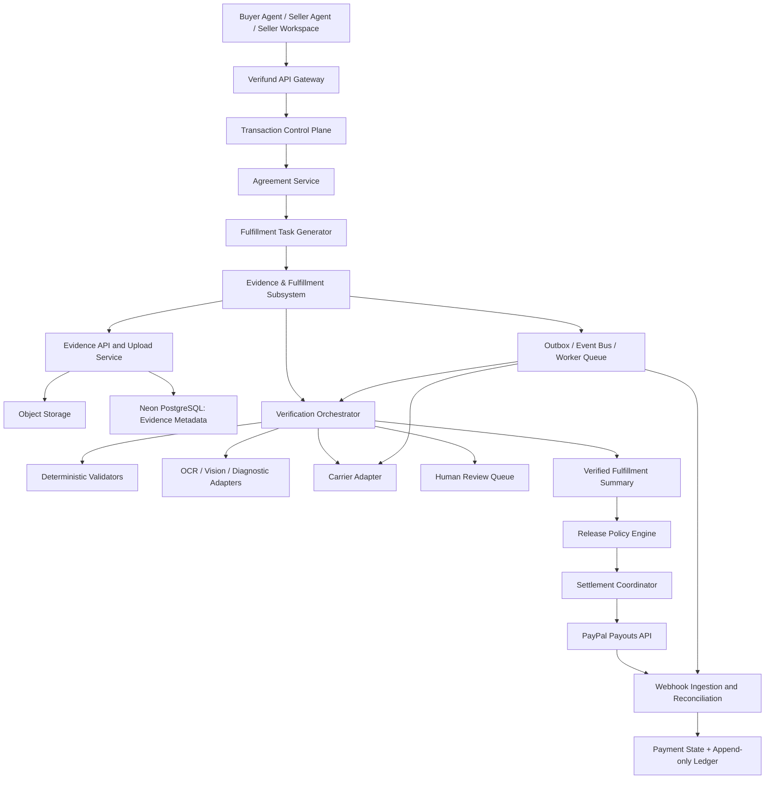
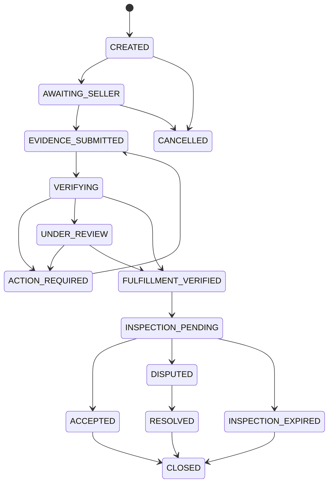
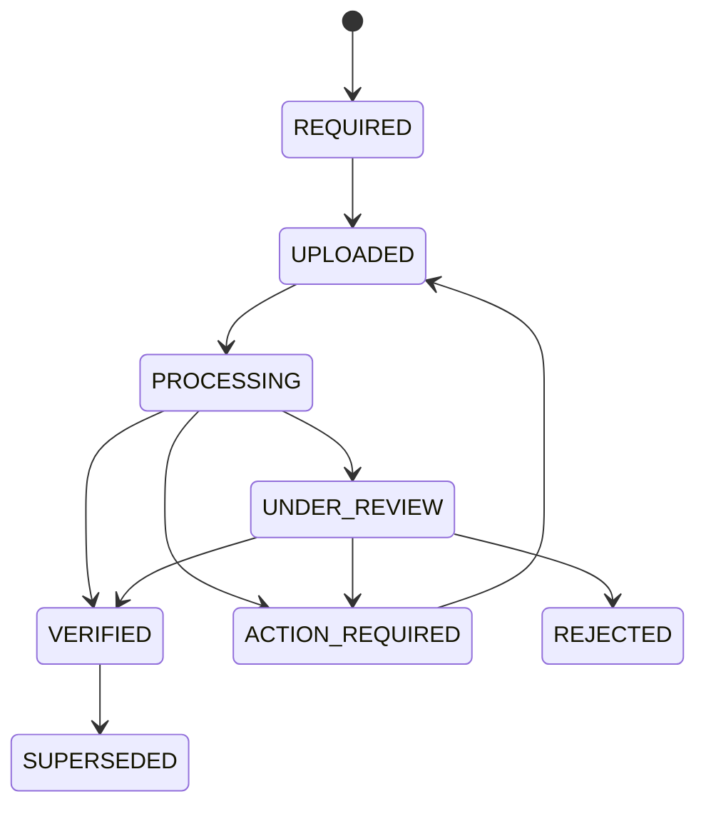
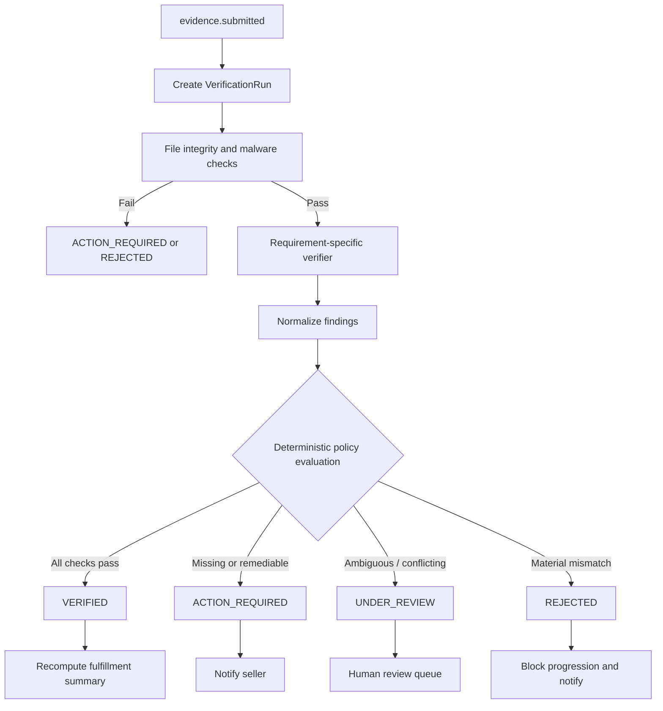
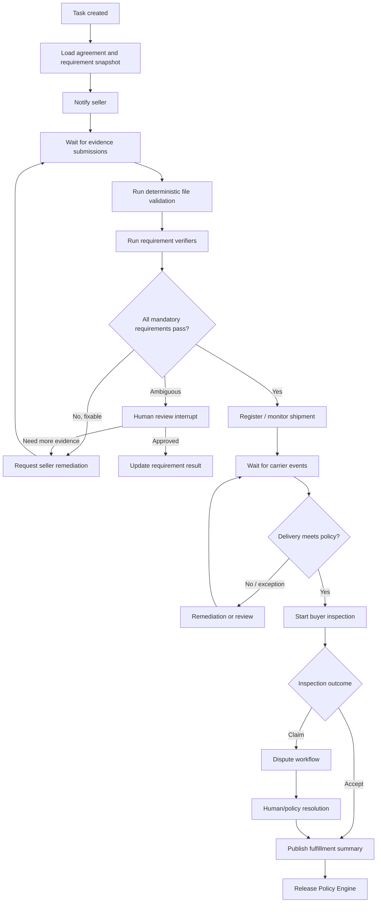

# Verifund Evidence & Fulfillment Subsystem
## Backend Architecture and Implementation Specification

**Status:** Recommended architecture  
**Project:** Verifund — A2A Commerce + PayPal + Conditional Settlement  
**Primary database:** Neon PostgreSQL  
**Backend style:** Modular monolith with asynchronous workers (initial implementation)  
**Workflow orchestration:** LangGraph for long-running workflows and human checkpoints; deterministic services for policy and financial decisions  
**Storage:** S3-compatible object storage for evidence files  
**Payment model:** PayPal Sandbox buyer payment to Verifund's Sandbox merchant account, internal transaction-ledger allocation, and a separate seller payout after release authorization.

---

## 1. Purpose and scope

This document specifies a dedicated **Evidence and Fulfillment subsystem** within Verifund's Transaction Control Plane.

The subsystem turns the obligations in an approved, versioned transaction agreement into a structured fulfillment task. It accepts seller evidence, stores and validates submissions, coordinates automated and human verification, records carrier events, supports buyer inspection and disputes, and provides a verified result to the settlement policy engine.

The subsystem does **not** independently move money or decide financial entitlement. It produces trustworthy, auditable facts and verification outcomes. A separate deterministic Release Policy Engine evaluates those outcomes alongside payment state, agreement terms, inspection status, dispute state, and other transaction constraints. Only the Settlement Coordinator may request a PayPal payout, and only after an authorized release decision.

### 1.1 Core principles

1. **Agreement-driven:** fulfillment requirements are generated from the exact approved agreement version, not from an LLM's interpretation at runtime.
2. **Evidence is not verification:** upload success means only that Verifund received a file. It does not mean the claim is true or the requirement passed.
3. **Evidence is not a payout decision:** even verified delivery does not by itself authorize payout.
4. **Independent sources of truth:** agreement/transaction state belongs to Verifund; payment-provider state belongs to PayPal; carrier events belong to the carrier; evidence submissions are attributable to their submitters.
5. **Append-only history:** preserve original submissions, verification attempts, carrier events, policy decisions, reviewer actions, and settlement events. Corrections create new records.
6. **Fail safely:** missing, conflicting, stale, invalid, or ambiguous evidence must not silently pass. Use remediation or human review.
7. **Least privilege:** seller agents can submit evidence and request status, but cannot edit agreements, mark delivery verified, authorize payout, or write financial ledger entries.
8. **Replayable simulation:** the same interfaces must support fixtures and mock providers for deterministic end-to-end tests.
9. **Tenant isolation:** all business records are scoped to a tenant and authorized transaction participants.
10. **Idempotent external effects:** uploads, carrier events, webhooks, workflow jobs, and payout requests must tolerate retries without duplicate business effects.

---

## 2. Place in the Verifund transaction control plane

The subsystem sits between the approved agreement/payment lifecycle and settlement authorization.



### 2.1 Boundaries

| Component | Owns | Must not own |
|---|---|---|
| Buyer/Seller agents | Communication, explanations, task initiation, evidence requests | Authoritative transaction, verification, or payment state |
| Agreement Service | Approved agreement versions and obligations | Evidence truth or PayPal state |
| Fulfillment Task Generator | Requirement snapshots and fulfillment task lifecycle | Changing approved contract terms |
| Evidence Service | Evidence metadata, file references, hashes, access policy | Deciding payout eligibility |
| Verification Engine | Requirement-level findings and verification outcomes | Financial ledger or payout execution |
| Carrier Adapter | Normalized carrier events and provider references | Declaring contractual compliance on its own |
| Dispute Service | Claims, evidence bundles, reviewer outcomes | Directly moving funds |
| Release Policy Engine | Deterministic payout eligibility decision | Calling PayPal directly |
| Settlement Coordinator | Idempotent payout/refund/adjustment commands | Inventing verification results |
| PayPal Adapter | Provider API calls and provider response mapping | Verifund's commercial agreement state |

### 2.2 Modular monolith first

For the hackathon and initial production-shaped prototype, implement these as modules in one FastAPI backend and deploy background workers separately from the API process. Keep clear module boundaries and interfaces so components can be extracted into services later if scale or team ownership justifies it.

Do not start with many independently deployed microservices. Evidence upload, verification, carrier polling, and payout coordination already require distributed-systems discipline; a modular monolith reduces operational complexity while preserving the correct boundaries.

---

## 3. Recommended technology stack

| Concern | Recommendation | Notes |
|---|---|---|
| API | FastAPI + Pydantic | Authenticated REST endpoints and webhook handlers |
| Relational source of truth | Neon PostgreSQL | Transactions, agreements, evidence metadata, verification, disputes, ledger references |
| ORM/migrations | SQLAlchemy 2.x + Alembic | Explicit migrations and constraints |
| Evidence object storage | S3-compatible storage | Private buckets, short-lived presigned URLs, encryption |
| Background jobs | Redis-backed queue or durable task runner | Retries, scheduling, carrier polling, media processing |
| Workflow orchestration | LangGraph where durable pause/resume is useful | HITL and long-running workflow coordination |
| Deterministic policy | Python domain services | Pure functions or transaction-scoped services; no LLM decision authority |
| OCR/vision | Provider adapters | Pluggable, replaceable, confidence-aware |
| Carrier integration | Carrier adapter interface | Real carrier or mock carrier uses the same contract |
| Payments | PayPal adapter | Orders/capture/payout APIs as supported by the chosen payment flow |
| Frontend updates | SSE or WebSockets | Workspace status and verification progress |
| Observability | Structured logs, metrics, traces | Correlation IDs across transaction and workflow |
| Testing | Pytest + contract tests + scenario runner | Deterministic simulation and provider sandbox assertions |

**Important:** PostgreSQL is the authoritative source for transaction and evidence metadata. Object storage holds the binary files. Redis or a job queue is not the source of truth for business state. A vector database, if used elsewhere in Verifund, must not be authoritative for agreements, payment state, evidence status, or settlement.

---

## 4. Domain model and lifecycle

### 4.1 Main entities

- **FulfillmentTask:** one fulfillment process for a transaction and approved agreement version.
- **FulfillmentRequirement:** one obligation that must be satisfied, such as serial number, product photographs, diagnostic report, packing photographs, tracking, or proof of delivery.
- **EvidenceSubmission:** an immutable submission associated with a requirement and agreement version.
- **EvidenceFile:** metadata for one uploaded object, including storage key, hash, size, MIME type, and scan result.
- **VerificationRun:** one attempt to evaluate a submission or requirement.
- **VerificationFinding:** a structured result, observation, confidence, and supporting evidence reference.
- **CarrierShipment:** carrier and tracking reference associated with a fulfillment task.
- **CarrierEvent:** normalized, immutable event received from polling or webhook.
- **InspectionRecord:** buyer's inspection decision and supporting evidence.
- **Dispute:** buyer or seller claim, evidence bundle, status, and resolution.
- **HumanReviewCase:** queue item for ambiguous or high-impact decisions.
- **ReleaseEvaluation:** immutable policy evaluation result and rule version.
- **SettlementIntent:** idempotent request to pay, refund, or adjust.
- **AuditEvent:** append-only record of actor, action, entity, timestamp, and correlation identifiers.

### 4.2 Fulfillment task state machine

Use explicit states; do not overload one `status` column to represent every dimension.



A task may also have independent operational flags such as `shipment_status`, `verification_status`, and `inspection_status`. The overall task state is a summary, not a replacement for these dimensions.

### 4.3 Requirement state machine



Recommended statuses:

- `REQUIRED`
- `UPLOADED`
- `PROCESSING`
- `VERIFIED`
- `ACTION_REQUIRED`
- `UNDER_REVIEW`
- `REJECTED`
- `WAIVED` (only by an authorized policy/reviewer action with a reason)
- `SUPERSEDED`

A seller replacement must create a new submission. It must not overwrite the previous evidence or erase its findings.

---

## 5. Agreement-driven requirement generation

When the buyer approves an exact agreement version and the required payment milestone is confirmed, the Transaction Control Plane emits an event such as:

`transaction.payment_confirmed` or `fulfillment.create_requested`

The Fulfillment Task Generator:

1. Loads the immutable approved agreement version.
2. Reads the product/service obligations and release conditions.
3. Resolves the applicable category policy, such as `electronics.laptop.refurbished`.
4. Creates a fulfillment task.
5. Creates requirement records from a versioned policy template.
6. Stores a snapshot of the agreement version and policy version.
7. Emits `fulfillment.task_created`.
8. Notifies the Seller Agent and workspace.

The seller must not be able to edit the requirements in the workspace. A material change must use the agreement amendment flow, obtain required party approvals, and create a new agreement version. The system must then explicitly decide whether to amend the existing task or create a new task revision while preserving prior history.

### 5.1 Example laptop policy

```json
{
  "policy_key": "electronics.laptop.refurbished",
  "policy_version": 1,
  "requirements": [
    {"key": "serial_number", "mandatory": true, "stage": "product_baseline"},
    {"key": "serial_label_photo", "mandatory": true, "stage": "product_baseline"},
    {"key": "condition_photos", "mandatory": true, "stage": "product_baseline"},
    {"key": "provenance_challenge_photo", "mandatory": true, "stage": "product_baseline"},
    {"key": "hardware_diagnostic", "mandatory": true, "stage": "product_baseline"},
    {"key": "condition_declaration", "mandatory": true, "stage": "product_baseline"},
    {"key": "battery_report", "mandatory": true, "stage": "product_baseline"},
    {"key": "packing_photos", "mandatory": true, "stage": "shipment"},
    {"key": "sealed_package_photo", "mandatory": true, "stage": "shipment"},
    {"key": "tracking_number", "mandatory": true, "stage": "shipment"},
    {"key": "carrier_acceptance", "mandatory": true, "stage": "shipment"},
    {"key": "insurance_confirmation", "mandatory": false, "stage": "shipment"},
    {"key": "proof_of_delivery", "mandatory": true, "stage": "delivery"},
    {"key": "delivery_signature", "mandatory": false, "stage": "delivery"}
  ],
  "inspection_window_hours": 48,
  "signature_threshold_minor_units": 50000,
  "weight_anomaly_requires_review": true
}
```

This is an illustrative policy. Values, currency thresholds, signature requirements, insurance requirements, and inspection duration must be configurable by jurisdiction, category, transaction risk, carrier capability, and agreement terms. Do not hard-code a universal USD 500 insurance rule.

### 5.2 Snapshot the actual requirements

Store the resolved requirement set, policy version, and agreement version on the fulfillment task. Do not dynamically reinterpret old tasks whenever a policy template changes.

---

## 6. Evidence submission and file handling

### 6.1 Upload flow

1. Seller authenticates and opens the transaction workspace.
2. API checks tenant membership, transaction participation, seller role, task state, and requirement ownership.
3. API issues a short-lived presigned upload URL for a private object key.
4. Client uploads directly to object storage.
5. Client calls the completion endpoint with upload ID and metadata.
6. Backend verifies object existence, size, MIME signature, checksum, and allowed file type.
7. Backend runs malware/content scanning and media validation.
8. Backend records an immutable `EvidenceSubmission` and `EvidenceFile`.
9. Backend associates it with the exact fulfillment requirement and agreement version.
10. Backend writes an outbox event such as `evidence.submitted`.
11. Worker creates a verification run and updates the requirement to `PROCESSING`.
12. API returns a submission receipt. UI displays `UPLOADED` or `PROCESSING`, never `VERIFIED` prematurely.

### 6.2 File security controls

- Private bucket by default; no public evidence URLs.
- Presigned URLs with short expiration and narrowly scoped object keys.
- Allowlist file extensions and MIME types; inspect file signatures rather than trusting client headers.
- Enforce per-file and per-transaction size limits.
- Malware scan uploads before downstream parsing.
- Re-encode images and transcode videos in an isolated processing environment where appropriate.
- Strip or separately preserve sensitive EXIF metadata according to policy; do not trust client-supplied timestamps or GPS.
- Encrypt in transit and at rest.
- Use random object keys; never use user filenames as storage paths.
- Store SHA-256 (or stronger) hashes, byte size, MIME type, upload actor, and timestamps.
- Restrict access through authorization checks and short-lived download URLs.
- Define retention, deletion, legal hold, and privacy policies.
- Treat uploaded text, images, PDFs, and embedded instructions as untrusted data. Never let evidence content instruct an agent or backend to change policy.

### 6.3 Evidence record metadata

At minimum, persist:

- Evidence ID and submission ID.
- Tenant, transaction, fulfillment task, requirement, and agreement version IDs.
- Submitter actor ID and role.
- Object storage key and object version where available.
- SHA-256 hash, MIME type, byte size, original filename (sanitized).
- Client-submitted timestamp and server-received timestamp.
- Upload session ID and idempotency key.
- Malware scan and media validation statuses.
- Provenance challenge ID, if applicable.
- Supersedes/submission revision relationship.
- Access classification and retention policy.
- Processing and verification state.

Do not treat a file hash as proof that the underlying claim is true. A hash establishes integrity relative to the stored bytes; it does not establish who captured the image, when the depicted event happened, or whether the content is genuine.

---

## 7. Verification engine

The Verification Engine evaluates requirements, not vague whole-order impressions. Each verifier returns a structured result with rule version, inputs, findings, confidence (where relevant), and references to supporting evidence.

### 7.1 Verification pipeline



### 7.2 Laptop verification matrix

| Requirement | Inputs | Automated checks | Escalation conditions |
|---|---|---|---|
| Serial number | Structured value + label photo | OCR extraction, normalization, equality with agreement record | Illegible, conflicting, duplicate, unsupported OEM lookup |
| Product identity | Model/serial + catalog agreement | Model and variant consistency | OEM source unavailable or conflicting |
| Condition photos | Multi-angle photos + seller declaration | File integrity, coverage checks, image analysis for visible damage | Low confidence, suspected manipulation, ambiguous damage |
| Provenance challenge | One-time challenge + photo/capture metadata | Challenge match, expiry, transaction association | Reused/expired code, suspected edit |
| Hardware specs | Diagnostic output, screenshots, OEM lookup if available | Compare CPU/RAM/storage/GPU/OS against agreement | Conflicting sources, unsupported device, unreliable screenshot |
| Battery | Battery report | Compare health/cycle values with agreed thresholds | Unsupported report or inconsistent values |
| Device locks | Seller declaration + supported device checks | Required declarations and available OEM/MDM checks | Corporate enrollment or activation lock unresolved |
| Packing photos | Unit/serial, inner packaging, shipping label | Serial match and required image coverage | Serial not visible or continuity unclear |
| Sealed package | Sealed-box image and label | Label/tracking association, image validation | Label mismatch or evidence gap |
| Insurance | Carrier/insurer confirmation | Coverage, declared value, insured amount, dates | Seller-only declaration without proof of coverage |
| Carrier acceptance | Tracking number and carrier events | Valid tracking, accepted/picked-up event | Label created only; no carrier custody event |
| Pickup weight | Carrier measurement | Compare with policy tolerance and expected package range | Large unexplained variance |
| Delivery | Carrier event/POD | Delivered event, destination/service checks, required signature | Delivery conflict, no POD where mandatory |
| Buyer inspection | Buyer decision and evidence | Deadline, required fields, evidence association | Claim, disagreement, missing material confirmation |

### 7.3 Evidence quality and confidence

OCR, computer vision, and LLM-based extraction may produce observations, but they must not independently make a financial decision. Use deterministic comparisons for objective fields such as serial equality, RAM minimum, storage minimum, delivery event presence, and deadline calculations.

For AI-assisted checks:

- Persist model/provider, model version, prompt/rule version, confidence, and raw structured output.
- Use explicit thresholds and calibrated confidence where feasible.
- Low confidence means `UNDER_REVIEW`, not automatic pass.
- Require human review for high-impact ambiguous findings.
- Never infer that a seller is fraudulent from one weak signal.
- Make the evidence and finding available to the reviewer.

### 7.4 Provenance limitations

A one-time code displayed in a photograph helps associate an image with a transaction, but does not prove that the image was captured live or is unaltered. For stronger assurance, combine a short-lived challenge with a controlled capture flow, server-side upload session, media integrity checks, and cross-evidence consistency. Clearly label simulated or fixture-generated media in sandbox mode.

---

## 8. Carrier and shipment integration

Implement a provider-neutral interface so real carrier APIs and the mock carrier use the same contract.

```python
from typing import Protocol

class CarrierAdapter(Protocol):
    async def register_tracking(self, tracking_number: str) -> dict: ...
    async def get_tracking_events(self, tracking_number: str) -> list[dict]: ...
    async def get_proof_of_delivery(self, tracking_number: str) -> dict | None: ...
```

### 8.1 Normalize carrier events

Map provider-specific statuses to a controlled vocabulary:

- `LABEL_CREATED`
- `CARRIER_ACCEPTED`
- `PICKED_UP`
- `IN_TRANSIT`
- `OUT_FOR_DELIVERY`
- `DELIVERED`
- `DELIVERED_SIGNED`
- `DELIVERY_EXCEPTION`
- `DELIVERY_FAILED`
- `RETURN_TO_SENDER`
- `LOST`
- `UNKNOWN`

Persist the raw provider payload (subject to privacy and retention rules), normalized event, provider event ID, event time, received time, tracking reference, and adapter version.

### 8.2 Carrier event rules

- A label-created event is not proof of dispatch.
- Carrier acceptance/pickup is the evidence of carrier custody.
- A delivered scan is not proof of product contents or condition.
- Signature and proof-of-delivery requirements depend on the agreement and policy.
- Weight comparison is an anomaly signal, not conclusive proof of contents.
- Missing carrier weight should be represented as unavailable, not fabricated.
- Duplicate and out-of-order events must be handled idempotently.
- Polling should use bounded backoff and stop or change cadence after terminal events.
- Carrier webhooks must be authenticated where supported.
- Keep raw and normalized events for audit and dispute review.

### 8.3 Delivery timeout

A delivery deadline comes from the agreement or configured policy. If it expires without acceptable delivery evidence, transition to a timeout/remediation path. Do not automatically decide a refund or void without consulting the payment state and approved transaction policy. In the current Verifund model, the buyer payment may already have been captured into Verifund's Sandbox merchant account; the appropriate remedy may therefore be a refund, not a pre-capture void.

---

## 9. Buyer inspection and disputes

### 9.1 Inspection lifecycle

After the delivery requirement is verified, calculate the inspection deadline from the authoritative carrier delivery timestamp and the approved agreement's inspection rule. Store the calculated deadline and the rule version.

The buyer may:

- Accept the product.
- Report a discrepancy and attach evidence.
- Request a negotiated remedy.
- Open a dispute.

The inspection UI should show the deadline and the exact obligations being checked. A buyer's silence must be handled according to the explicit agreement and policy; do not assume that silence is acceptance unless the terms and applicable rules support that behavior.

### 9.2 Dispute evidence bundle

A dispute bundle should include:

- Approved agreement and version.
- Original seller baseline evidence.
- Seller shipment and packing evidence.
- Carrier events and proof of delivery.
- Buyer inspection evidence.
- All verification runs and findings.
- Communication and negotiation records relevant to the claim.
- Human reviewer actions and rationale.
- Policy version and settlement evaluation.

### 9.3 Dispute categories for laptop simulation

| Claim | Evidence compared | Expected handling |
|---|---|---|
| Empty box | Packing images, carrier acceptance weight, delivery/POD, buyer unboxing evidence | Investigate; weight and packing photos are supporting evidence, not conclusive proof |
| Different laptop | Deal serial, packing serial, buyer-received serial | Serial mismatch is a material discrepancy; human review if chain is incomplete |
| Undisclosed scratches | Original baseline photos/declaration vs buyer photos | Compare disclosed and new damage; review ambiguity |
| Does not power on | Pre-shipment boot/diagnostic evidence vs buyer video/report | Establish pre-shipment baseline; investigate transit damage and warranty obligations |
| Missing accessory | Agreement accessory list, packing evidence, buyer evidence | Verify the exact contractual obligation |
| Partial agreement | Accepted negotiated remedy and party approvals | Create an explicit settlement adjustment; never infer a split |

AI may summarize the bundle and recommend an outcome. A deterministic policy and authorized human reviewer must control the resolution and permitted financial action.

---

## 10. Release Policy Engine and settlement boundary

The Evidence and Fulfillment subsystem publishes a verified fulfillment summary. It does not call PayPal.

### 10.1 Payout eligibility inputs

The Release Policy Engine should evaluate at least:

1. Exact agreement version is approved and remains applicable.
2. Buyer payment is confirmed by PayPal and reconciled to Verifund's transaction ledger.
3. All mandatory fulfillment requirements are verified or explicitly waived by an authorized actor under policy.
4. Carrier delivery is verified when delivery is required.
5. Buyer inspection is resolved according to the agreement.
6. No unresolved dispute, fraud hold, chargeback, compliance hold, or payment restriction blocks release.
7. Seller payout recipient is valid and authorized.
8. No prior payout exists for the same settlement intent/version.
9. Amount, currency, fees, and any approved adjustment reconcile.
10. The policy version and evidence snapshot are recorded.

### 10.2 Example policy pseudocode

```python
def evaluate_release(tx, agreement, payment, fulfillment, inspection, dispute, seller):
    blockers = []

    if not agreement.is_approved:
        blockers.append("AGREEMENT_NOT_APPROVED")

    if payment.provider_status != "COMPLETED":
        blockers.append("BUYER_PAYMENT_NOT_CONFIRMED")

    if not payment.ledger_reconciled:
        blockers.append("PAYMENT_NOT_RECONCILED")

    if not fulfillment.all_mandatory_requirements_verified:
        blockers.append("FULFILLMENT_REQUIREMENTS_INCOMPLETE")

    if fulfillment.delivery_required and not fulfillment.delivery_verified:
        blockers.append("DELIVERY_NOT_VERIFIED")

    if not inspection.is_resolved:
        blockers.append("INSPECTION_NOT_RESOLVED")

    if dispute.has_unresolved_dispute:
        blockers.append("UNRESOLVED_DISPUTE")

    if not seller.payout_recipient_valid:
        blockers.append("PAYOUT_RECIPIENT_INVALID")

    if tx.has_active_compliance_hold:
        blockers.append("COMPLIANCE_HOLD")

    return {
        "eligible": len(blockers) == 0,
        "blockers": blockers,
    }
```

This is illustrative domain logic. Production implementation must load authoritative state inside a database transaction and enforce concurrency/uniqueness constraints. It must not trust client-supplied booleans.

### 10.3 Current Verifund payment model

Keep these events distinct:

1. Buyer completes PayPal checkout.
2. PayPal confirms capture to Verifund's Sandbox merchant account.
3. Verifund records the provider result and corresponding internal ledger entries.
4. Fulfillment and inspection complete.
5. Release Policy Engine records `PAYOUT_ELIGIBLE`.
6. Settlement Coordinator creates an idempotent payout intent.
7. PayPal payout request is submitted.
8. Webhook or reconciliation confirms provider status.
9. Verifund records the final payout and ledger entries.

Do not describe this prototype as a legally regulated escrow account or claim that PayPal holds funds in escrow. Production fund custody, safeguarding, payment flows, and marketplace payout design require legal and provider review.

### 10.4 Idempotency and financial safety

- Unique payout intent per transaction and settlement version.
- Persist the payout intent before making the provider request.
- Use provider idempotency support where available.
- Handle timeouts as `UNKNOWN` until reconciled; never blindly retry an ambiguous payment request.
- Verify webhooks and deduplicate provider event IDs.
- Reconcile provider state periodically.
- Ledger entries are append-only; corrections use compensating entries.
- Never let the LLM or evidence verifier create ledger entries or call the payout API.

---

## 11. Database schema proposal

The following is a logical schema. Adapt naming, enums, indexes, and foreign keys to the existing Verifund database and multi-tenant model.

### 11.1 Core tables

| Table | Important fields |
|---|---|
| `fulfillment_tasks` | `id`, `tenant_id`, `transaction_id`, `agreement_version_id`, `policy_key`, `policy_version`, `status`, `created_at`, `inspection_deadline` |
| `fulfillment_requirements` | `id`, `task_id`, `requirement_key`, `stage`, `mandatory`, `status`, `config_snapshot`, `created_at` |
| `evidence_submissions` | `id`, `tenant_id`, `task_id`, `requirement_id`, `agreement_version_id`, `submitted_by`, `revision`, `status`, `submitted_at`, `supersedes_id` |
| `evidence_files` | `id`, `submission_id`, `storage_key`, `sha256`, `mime_type`, `size_bytes`, `original_filename`, `scan_status`, `created_at` |
| `verification_runs` | `id`, `task_id`, `requirement_id`, `submission_id`, `verifier_key`, `verifier_version`, `status`, `started_at`, `completed_at` |
| `verification_findings` | `id`, `run_id`, `finding_code`, `severity`, `result`, `confidence`, `details_json`, `evidence_file_id` |
| `product_identifiers` | `id`, `transaction_id`, `agreement_version_id`, `identifier_type`, `identifier_value`, `source_evidence_id` |
| `carrier_shipments` | `id`, `task_id`, `carrier_key`, `tracking_number`, `service_level`, `declared_value_minor`, `currency`, `status` |
| `carrier_events` | `id`, `shipment_id`, `provider_event_id`, `normalized_status`, `event_at`, `received_at`, `payload_json` |
| `delivery_confirmations` | `id`, `shipment_id`, `delivered_at`, `recipient_reference`, `signature_reference`, `pod_evidence_id` |
| `inspection_records` | `id`, `task_id`, `buyer_id`, `status`, `decision`, `submitted_at`, `deadline_at` |
| `disputes` | `id`, `transaction_id`, `task_id`, `opened_by`, `claim_type`, `status`, `resolution`, `resolved_by`, `resolved_at` |
| `human_review_cases` | `id`, `task_id`, `verification_run_id`, `reason_code`, `priority`, `status`, `assigned_to`, `decision`, `rationale` |
| `release_evaluations` | `id`, `transaction_id`, `agreement_version_id`, `policy_version`, `eligible`, `blockers_json`, `evaluated_at`, `evidence_snapshot_hash` |
| `settlement_intents` | `id`, `transaction_id`, `settlement_version`, `type`, `amount_minor`, `currency`, `idempotency_key`, `status`, `provider_reference` |
| `outbox_events` | `id`, `aggregate_type`, `aggregate_id`, `event_type`, `payload_json`, `created_at`, `published_at` |
| `audit_events` | `id`, `tenant_id`, `actor_type`, `actor_id`, `action`, `entity_type`, `entity_id`, `correlation_id`, `details_json`, `created_at` |

### 11.2 Database constraints and indexes

- Foreign keys from every fulfillment record to tenant and transaction scope.
- Unique `(transaction_id, agreement_version_id)` for a single active fulfillment task, unless the business model explicitly supports multiple tasks.
- Unique `(task_id, requirement_key)` within a task.
- Unique `(requirement_id, revision)` for evidence revisions.
- Unique `(carrier_key, provider_event_id)` where provider IDs are available.
- Unique idempotency keys for upload completion and settlement intents.
- Unique `(transaction_id, settlement_version, type)` for payout intents as appropriate.
- Index transaction, tenant, task status, requirement status, tracking number, and created timestamps.
- Use database transactions when updating requirement/task summaries and writing corresponding outbox events.
- Consider row-level security or strict tenant-scoped repository methods; application authorization is still required.
- Use integer minor units for monetary amounts and always store currency.

---

## 12. API design

All endpoints require authentication and authorization. The examples below are illustrative; align route naming with the existing API conventions.

### 12.1 Seller fulfillment

```http
GET    /api/v1/transactions/{transaction_id}/fulfillment
GET    /api/v1/fulfillment-tasks/{task_id}
GET    /api/v1/fulfillment-tasks/{task_id}/requirements
POST   /api/v1/fulfillment-requirements/{requirement_id}/uploads
POST   /api/v1/evidence-uploads/{upload_id}/complete
GET    /api/v1/evidence-submissions/{submission_id}
POST   /api/v1/evidence-submissions/{submission_id}/supersede
POST   /api/v1/fulfillment-tasks/{task_id}/shipment
GET    /api/v1/fulfillment-tasks/{task_id}/activity
```

### 12.2 Buyer inspection and disputes

```http
GET    /api/v1/buyer/transactions/{transaction_id}/inspection
POST   /api/v1/inspection-records/{inspection_id}/accept
POST   /api/v1/inspection-records/{inspection_id}/claims
POST   /api/v1/disputes/{dispute_id}/evidence
GET    /api/v1/disputes/{dispute_id}
```

### 12.3 Internal and reviewer endpoints

```http
GET    /internal/verification-runs/{run_id}
POST   /internal/verification-runs/{run_id}/retry
GET    /internal/review-queue
POST   /internal/review-cases/{case_id}/decision
POST   /internal/fulfillment-tasks/{task_id}/recompute
```

Protect internal routes with service authentication and role-based authorization. Human reviewer decisions must record the reviewer, reason, policy basis, and timestamp.

### 12.4 Upload initiation response

```json
{
  "upload_id": "upl_123",
  "evidence_submission_id": "evs_123",
  "requirement_id": "req_serial_photo",
  "agreement_version_id": "agr_v1",
  "upload_url": "https://private-storage.example/presigned",
  "expires_at": "2026-11-12T12:15:00Z",
  "required_headers": {
    "Content-Type": "image/jpeg"
  }
}
```

### 12.5 Submission receipt

```json
{
  "submission_id": "evs_123",
  "task_id": "ful_2048",
  "transaction_id": "VF-2048",
  "requirement_key": "serial_label_photo",
  "agreement_version": 1,
  "status": "PROCESSING",
  "submitted_at": "2026-11-12T12:05:00Z",
  "verification_run_id": "vr_123"
}
```

The client must not be able to submit `VERIFIED`, `DELIVERED`, `PAYOUT_ELIGIBLE`, or other authoritative state values.

---

## 13. Events and asynchronous processing

Use a transactional outbox pattern: commit domain changes and their outbox event in the same database transaction, then publish asynchronously. Consumers must be idempotent.

### 13.1 Suggested domain events

- `fulfillment.task_created`
- `fulfillment.requirements_generated`
- `evidence.upload_initiated`
- `evidence.submitted`
- `evidence.validation_completed`
- `verification.started`
- `verification.completed`
- `verification.action_required`
- `verification.review_requested`
- `verification.requirement_verified`
- `shipment.registered`
- `carrier.event_received`
- `delivery.verified`
- `inspection.started`
- `inspection.accepted`
- `dispute.opened`
- `dispute.resolved`
- `fulfillment.verified`
- `release.evaluated`
- `settlement.payout_requested`
- `settlement.payout_confirmed`
- `settlement.payout_failed`

### 13.2 Event envelope

```json
{
  "event_id": "evt_01J...",
  "event_type": "evidence.submitted",
  "occurred_at": "2026-11-12T12:05:00Z",
  "tenant_id": "tenant_123",
  "transaction_id": "VF-2048",
  "aggregate_type": "fulfillment_task",
  "aggregate_id": "ful_2048",
  "agreement_version_id": "agr_v1",
  "correlation_id": "corr_123",
  "causation_id": "cmd_123",
  "schema_version": 1,
  "data": {
    "submission_id": "evs_123",
    "requirement_id": "req_serial_photo"
  }
}
```

### 13.3 Worker responsibilities

- File validation and malware scanning.
- OCR, image, video, and diagnostic processing.
- Requirement verification.
- Carrier polling and webhook normalization.
- Inspection deadline scheduling.
- Notification delivery.
- Human-review queue management.
- Release reevaluation when relevant facts change.
- PayPal webhook processing and reconciliation (owned by the payment module).

Use retries with exponential backoff and jitter. Define maximum attempts, dead-letter handling, alerting, and manual replay. Do not let a worker's retry create duplicate evidence, carrier events, ledger entries, or payouts.

---

## 14. LangGraph orchestration and agent responsibilities

LangGraph is appropriate for coordinating long-running workflows that wait for seller uploads, carrier events, buyer inspection, or human review. It should not replace deterministic domain services or the database state machine.

### 14.1 Suggested fulfillment graph



### 14.2 Graph nodes should call services

Example node responsibilities:

- `load_task_snapshot`
- `notify_seller`
- `await_evidence_event`
- `validate_submission`
- `verify_requirement`
- `request_remediation`
- `open_human_review`
- `register_shipment`
- `poll_carrier`
- `start_inspection`
- `route_dispute`
- `publish_fulfillment_summary`

Each node should call a typed service interface and persist checkpoint state. Avoid putting business rules only in prompts.

### 14.3 Seller Agent boundary

The Seller Agent can:

- Explain agreement obligations.
- Tell the seller which evidence is missing.
- Open the secure fulfillment workspace.
- Collect structured declarations.
- Submit seller-authorized evidence through the Evidence API.
- Report verification progress and remediation requests.

The Seller Agent cannot:

- Change the approved agreement.
- fabricate or edit evidence on the seller's behalf and present it as genuine.
- mark its own evidence verified.
- assert carrier delivery without carrier data.
- resolve disputes on its own.
- authorize or execute payout.

---

## 15. Security, privacy, and audit

### 15.1 Authorization

Enforce role and resource checks on every read/write:

- Seller: own seller account and assigned transaction only.
- Buyer: own buyer account and transaction inspection/dispute actions only.
- Reviewer: assigned review cases and permitted evidence.
- Internal service: only its scoped service permissions.
- Admin: audited break-glass access, not routine unrestricted access.

A transaction-specific link sent through messaging is not sufficient authorization by itself. Use an authenticated session or a short-lived, single-use, revocable token with narrow scope, and require stronger authentication for sensitive actions.

### 15.2 Audit trail

Record:

- Who submitted or accessed evidence.
- Which requirement and agreement version it supports.
- Original and superseding submissions.
- File hashes and object references.
- Every verifier and version used.
- All findings, status transitions, and policy decisions.
- Human reviewer decisions and rationale.
- Carrier source events and provider references.
- Every release evaluation and settlement intent.
- PayPal request/response references and webhook events.

For tamper evidence, consider hash-linking audit events or exporting signed periodic audit checkpoints. A hash chain makes unauthorized modification detectable only if checkpoints or signing keys are protected independently; it is not a substitute for access control, backups, or provider records.

### 15.3 Privacy and retention

Serial numbers, addresses, recipient names, signatures, photos, and diagnostic reports may be sensitive personal or device data. Define purpose limitation, access controls, retention windows, deletion workflows, legal holds, and disclosure policies. Avoid storing unnecessary identity documents or full payment credentials.

---

## 16. Simulated fulfillment mode

The simulation must exercise the same application interfaces, domain state transitions, and policy engine as production-shaped integrations. Only the adapters change.

### 16.1 Adapter selection

```python
if settings.FULFILLMENT_MODE == "sandbox":
    carrier = MockCarrierAdapter(scenario_store)
    oem = FixtureOemAdapter(fixture_store)
    media = FixtureMediaVerifier(fixture_store)
else:
    carrier = ProductionCarrierAdapter(...)
    oem = ProductionOemAdapter(...)
    media = ProductionMediaVerifier(...)
```

Do not scatter `if sandbox` branches throughout business logic. Inject adapters at the application boundary.

### 16.2 Suggested fixture structure

```text
fixtures/
└── laptop/
    ├── happy_path/
    │   ├── product/
    │   ├── provenance/
    │   ├── diagnostics/
    │   ├── packaging/
    │   └── buyer_inspection/
    ├── specs_mismatch/
    ├── packing_photo_missing/
    ├── weight_anomaly/
    ├── never_delivers/
    ├── dispute_seller_wins/
    └── dispute_buyer_wins/
```

Clearly label generated or synthetic fixtures as simulated. Do not present fixture outputs as real carrier, OEM, capture, or delivery attestations.

### 16.3 Scenario definitions

| Scenario | Setup | Expected result |
|---|---|---|
| `happy_path` | All required evidence passes; carrier accepts and delivers with required POD; buyer accepts | Payout becomes eligible; payout confirmation comes from PayPal Sandbox |
| `specs_mismatch` | Diagnostic specs fail agreement threshold | Product requirement fails; no fulfillment progression |
| `packing_photo_missing` | Mandatory packing image absent | Action required; no shipment verification |
| `weight_anomaly` | Carrier pickup weight is implausible | Human review or remediation |
| `never_delivers` | Carrier remains in transit past deadline | Delivery timeout; release blocked; configured refund/cancellation path evaluated |
| `dispute_seller_wins` | Buyer alleges empty box; seller chain is strong but not conclusive | Human/policy resolution; if seller prevails, release may become eligible |
| `dispute_buyer_wins` | Credible evidence of undisclosed material damage | Buyer-favorable resolution and authorized refund/adjustment |
| `partial_agreement` | Both parties explicitly approve an agreed partial remedy | Settlement adjustment created and reconciled |

### 16.4 Compressed time

Use configurable test durations to complete workflows in minutes. Keep production policy values separate from test configuration. Tests must assert both Verifund's final state and the PayPal Sandbox provider state; internal state alone is not proof that a payment operation succeeded.

---

## 17. Observability and operational controls

Use structured logs and traces with:

- `tenant_id`
- `transaction_id`
- `fulfillment_task_id`
- `requirement_id`
- `evidence_submission_id`
- `verification_run_id`
- `carrier_shipment_id`
- `workflow_run_id`
- `correlation_id`
- `provider_reference`

Never log file contents, access tokens, presigned URLs, full serial numbers, signatures, or sensitive personal information.

### 17.1 Key metrics

- Fulfillment tasks created and completed.
- Time from task creation to first seller submission.
- Evidence upload failure rate.
- Verification pass/fail/action-required rates by requirement.
- Human-review rate and resolution time.
- Carrier polling errors and stale shipments.
- Delivery exception and timeout rates.
- Inspection acceptance/dispute rates.
- Release blocked reasons.
- Payout intent success/failure/unknown rates.
- Webhook processing lag and reconciliation discrepancies.

Alert on stuck verification runs, stale carrier tracking, unprocessed outbox events, dead-letter growth, repeated webhook failures, and payout states that remain unknown.

---

## 18. Testing strategy

### 18.1 Unit tests

- Requirement generation from agreement and policy snapshots.
- Serial normalization and equality.
- Hardware threshold comparisons.
- Requirement status transitions.
- Inspection deadline calculation.
- Release policy blocker evaluation.
- Idempotency-key handling.
- Tenant authorization and access control.

### 18.2 Integration tests

- Presigned upload and upload completion.
- Malware/format validation.
- Evidence-to-requirement association.
- Verification worker and database persistence.
- Carrier event ingestion and duplicate handling.
- Outbox publishing and consumer retry.
- Human review pause/resume.
- PayPal webhook signature verification and deduplication.
- Settlement reconciliation.

### 18.3 End-to-end acceptance tests

For each scenario, assert:

1. Correct agreement version is used.
2. Exact mandatory requirements are generated.
3. Seller can submit only to authorized requirements.
4. Evidence records and hashes persist.
5. Verification results are reproducible and traceable.
6. Carrier events are normalized and deduplicated.
7. Buyer inspection and dispute windows behave correctly.
8. Release Policy Engine returns expected blockers or eligibility.
9. Settlement Coordinator creates no duplicate payout.
10. PayPal Sandbox state and Verifund ledger agree.

### 18.4 Critical negative tests

- Seller attempts to submit evidence to another seller's transaction.
- Client tries to set a requirement to `VERIFIED`.
- Seller tries to edit the agreement snapshot.
- Duplicate upload completion request.
- Same carrier webhook delivered multiple times.
- Out-of-order carrier events.
- Evidence file replaced after verification.
- Verification provider timeout.
- LLM returns an unsupported verdict.
- Dispute opened while payout worker is running.
- PayPal payout request times out after provider may have accepted it.
- Tenant ID is changed in request payload.
- Presigned URL expires or is reused outside its scope.

---

## 19. Recommended repository structure

Adapt to the existing Verifund codebase; this is a proposed module layout rather than a requirement to split into separate services.

```text
backend/
├── app/
│   ├── main.py
│   ├── api/
│   │   ├── dependencies.py
│   │   └── v1/
│   │       ├── fulfillment.py
│   │       ├── evidence.py
│   │       ├── inspection.py
│   │       └── disputes.py
│   ├── transaction_control/
│   │   ├── agreements/
│   │   ├── fulfillment/
│   │   │   ├── domain/
│   │   │   │   ├── models.py
│   │   │   │   ├── states.py
│   │   │   │   └── events.py
│   │   │   ├── application/
│   │   │   │   ├── task_generator.py
│   │   │   │   ├── evidence_service.py
│   │   │   │   ├── verification_service.py
│   │   │   │   ├── carrier_service.py
│   │   │   │   └── inspection_service.py
│   │   │   ├── infrastructure/
│   │   │   │   ├── repositories/
│   │   │   │   ├── storage/
│   │   │   │   ├── adapters/
│   │   │   │   │   ├── carrier/
│   │   │   │   │   ├── oem/
│   │   │   │   │   ├── vision/
│   │   │   │   │   └── diagnostics/
│   │   │   │   └── workers/
│   │   │   └── policies/
│   │   │       ├── electronics_laptop.py
│   │   │       └── registry.py
│   │   ├── disputes/
│   │   ├── release_policy/
│   │   ├── settlement/
│   │   └── ledger/
│   ├── workflows/
│   │   └── fulfillment_graph.py
│   ├── integrations/
│   │   ├── paypal/
│   │   └── messaging/
│   ├── events/
│   │   ├── outbox.py
│   │   └── consumers.py
│   ├── security/
│   └── observability/
├── migrations/
├── tests/
│   ├── unit/
│   ├── integration/
│   ├── contract/
│   └── e2e/
├── fixtures/
│   └── laptop/
└── pyproject.toml
```

---

## 20. Implementation sequence

Build incrementally, keeping the happy path executable at every stage.

### Phase 1 — Domain foundation

- Define fulfillment task, requirement, evidence, and verification models.
- Implement agreement-driven requirement generation.
- Add database migrations, tenant scoping, state transitions, and audit events.
- Seed the laptop policy and one approved agreement fixture.

**Exit criterion:** an approved transaction creates the correct immutable fulfillment checklist.

### Phase 2 — Evidence intake

- Implement presigned upload and completion endpoints.
- Add file validation, malware scanning, hashes, metadata, and immutable submission history.
- Build requirement-level evidence association and submission receipts.

**Exit criterion:** seller can upload evidence securely and see `PROCESSING`, with no premature verification status.

### Phase 3 — Deterministic verification

- Implement serial, specification, condition declaration, and required-file checks.
- Add OCR/vision adapters behind interfaces.
- Add action-required and human-review states.

**Exit criterion:** `happy_path` passes and `specs_mismatch` is blocked with explainable findings.

### Phase 4 — Shipment and delivery

- Implement carrier adapter contract and mock carrier.
- Persist normalized carrier events.
- Add tracking polling, signature policy, weight anomaly checks, and delivery timeout.

**Exit criterion:** happy-path delivery verifies; `never_delivers` and `weight_anomaly` remain blocked or escalated.

### Phase 5 — Inspection and disputes

- Add buyer inspection deadline and decision endpoints.
- Implement dispute evidence bundles and reviewer decisions.
- Add buyer-win, seller-win, and explicitly agreed partial-remedy scenarios.

**Exit criterion:** unresolved disputes block payout eligibility.

### Phase 6 — Release and PayPal integration

- Implement deterministic release policy.
- Create idempotent settlement intents.
- Integrate PayPal payout request, webhooks, and reconciliation.
- Add append-only ledger postings and provider-state assertions.

**Exit criterion:** a successful fulfillment scenario produces exactly one confirmed Sandbox seller payout; failure scenarios produce no unauthorized payout.

### Phase 7 — Seller experience and operational readiness

- Connect Seller Fulfillment Workspace and Seller Agent notifications.
- Add SSE/WebSocket progress updates.
- Add dashboards, alerts, dead-letter handling, replay tools, retention controls, and security tests.

**Exit criterion:** a seller can complete the process end-to-end and reviewers can reconstruct every decision.

---

## 21. Definition of done

The subsystem is ready for the Verifund prototype when:

- [ ] Fulfillment requirements are generated from the exact approved agreement version.
- [ ] Requirements are policy-versioned and immutable for the task.
- [ ] Evidence files are private, validated, hashed, and associated with the correct requirement.
- [ ] Original submissions and revisions are preserved.
- [ ] Verification is requirement-level and auditable.
- [ ] Ambiguous findings can be routed to human review.
- [ ] Carrier events are normalized, deduplicated, and traceable.
- [ ] Delivery and buyer inspection are separate states.
- [ ] Disputes block payout until resolved.
- [ ] Release decisions are deterministic, versioned, and explainable.
- [ ] Only the Settlement Coordinator can request seller payout.
- [ ] PayPal provider state is reconciled with Verifund's internal ledger.
- [ ] Retries and duplicate events cannot create duplicate payouts.
- [ ] Sandbox fixtures exercise success, failure, timeout, and dispute paths.
- [ ] Tenant isolation, audit, privacy, and file-security tests pass.

---

## 22. Final architectural recommendation

Treat evidence as a first-class domain within Verifund's Transaction Control Plane—not as a collection of attachments and not as an agent feature.

The approved agreement defines what must be fulfilled. The Evidence and Fulfillment subsystem records what the seller submits and what independent sources report. The Verification Engine determines which requirements pass, need remediation, or require review. Buyer inspection and dispute resolution establish whether the transaction's post-delivery conditions are satisfied. The Release Policy Engine then evaluates the complete, versioned transaction record. Finally, the Settlement Coordinator performs and reconciles the permitted PayPal action.

This separation gives Verifund a defensible and testable chain:

**Approved agreement → fulfillment requirements → immutable evidence → requirement verification → carrier-confirmed delivery → buyer inspection/dispute resolution → deterministic release evaluation → idempotent seller payout.**

The AI agents make the experience conversational and help people complete the workflow. They do not become the authority for evidence truth, contract changes, financial accounting, or payment release.
