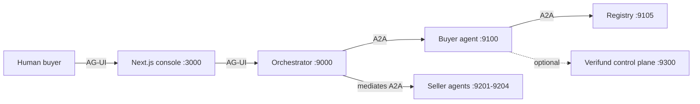
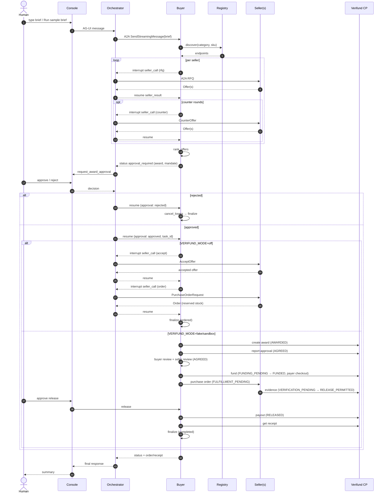

# MarketMesh End-to-End Workflow

This document traces the complete MarketMesh workflow from the moment a human clicks
**"Ask agent to negotiate"** in the console all the way through to the seller receiving
a payout and the transaction closing with a signed receipt. It covers both the default
off-mode commerce path and the optional Verifund settlement path, and shows where they
diverge.

> Related: [`README.md`](../README.md), [`docs/architecture.md`](architecture.md),
> [`docs/verifund-paypal-sandbox.md`](verifund-paypal-sandbox.md).

---

## 1. Overview

MarketMesh is a multi-agent commerce exchange. A human buyer describes a sourcing need
in the console. An orchestrator agent coordinates a buyer agent, which discovers
independent seller agents through a registry, negotiates structured offers over A2A,
ranks them deterministically, and **stops for human approval before any order is created**.
After approval the flow either (a) places a purchase order with the winning seller
(off-mode), or (b) runs a full held-funds settlement lifecycle ending in a payout and
signed receipt (Verifund mode).



---

## 2. Actors and service boundaries

| Service | Port | Owns | Does not own |
|---|---|---|---|
| Console | 3000 | UI state, CopilotKit chat, approval presentation, trace/registry proxies | Prices, mandate validation, orders |
| Orchestrator | 9000 | AG-UI entrypoint, mediated buyer/seller coordination, seller-call resumption | Mandate validation, ranking, stock, order IDs |
| Buyer agent | 9100 | Mandate, discovery, negotiation orchestration, ranking, approval interrupt, purchase orders | Seller stock, seller cost floors |
| Registry | 9105 | Agent Card index, categories, card hashes, health | Negotiation, trust decisions, orders |
| Seller agents | 9201-9204 | Catalog policy, quote generation, negotiation choices, stock, reservations, order IDs | Buyer budget, ranking, human approval |
| Verifund control plane | 9300 | Settlement state, held-funds ledger, evidence records, PayPal calls, receipts, audit | Mandate, ranking, seller stock |

Protocols: **AG-UI** (human-facing, streaming, interrupts) between browser/console/orchestrator;
**A2A 1.x JSON-RPC over HTTP** (SSE) between orchestrator/buyer/sellers. The console never
speaks A2A and never receives seller bearer tokens.

---

## 3. Entry point: "Ask agent to negotiate"

1. The human enters a sourcing brief in the CopilotKit chat rail (or clicks **Run sample brief**).
2. The console sends the brief over AG-UI to the orchestrator.
3. The orchestrator forwards it to the Buyer A2A agent as a new sourcing run, carrying the
   human's natural-language brief.
4. The buyer starts its LangGraph graph at `interpret_brief`, with `thread_id = run_id`.

The buyer graph (high level):

```
interpret_brief → discover_sellers → plan_sourcing → prepare_mediated
  → select_next_seller ↔ process_seller (one seller at a time, mediated)
  → rank_offers → await_approval (interrupt)
  → place_order ──┐
  └ reject → cancel_losers → finalize
```

---

## 4. Phase 1 — Sourcing and negotiation

### 4.1 Interpret brief (`interpret_brief`)

- Extracts the latest `HumanMessage`, parses it into a `Mandate` (product, quantity, budget,
  deadline, warranty, returns, preferences) using the planner (LLM or scripted fallback).
- Normalizes the mandate against the `Mandate` schema; a regex fallback exists if parsing fails.
- Guardrail: the RFQ must never contain `max_total_cents` (budget) in dollars or cents.
- Persists `stage = "brief_ready"` and the mandate.

### 4.2 Discover sellers (`discover_sellers`)

- Calls the registry for sellers matching `mandate.category` / `mandate.product_sku`.
- Independently validates each Agent Card (`validate_agent_card`); invalid cards are skipped and
  recorded as `card_rejected` trace frames.
- If no validated sellers remain, the run ends in `failed` (`no_validated_sellers`).

### 4.3 Plan sourcing (`plan_sourcing`)

- Composes a budget-safe RFQ message (`compose_rfq`), falling back to a deterministic template.
- Persists `stage = "sourcing_planned"`.

### 4.4 Negotiate per seller (`_mediated_process_seller`)

For each seller (mediated, one at a time):

1. **RFQ** — buyer builds an `RFQ` (request id `rfq-{run_id}-{seller}-mediated`) and pauses with
   an interrupt `kind="rfq"`. The orchestrator's `mediate_seller_call` forwards it to the seller.
   The seller quotes at policy price and returns structured `Offer`(s). The buyer revalidates each
   offer: seller ID, request ID, SKU, recomputed line-item and total arithmetic must match.
2. **Counter rounds** (up to 2) — buyer computes allowed counter targets via
   `counter_targets(unit_price, max_total_cents, quantity)` and sends a `CounterOffer`. The seller
   chooses an allowed concession or accepts/rejects. New offers are revalidated.
3. **Final offer** — the last offer becomes the seller's final offer; a `NegotiationRecord` is
   appended with status `final`/`rejected`/`error`.

Each seller pause is resumed by the orchestrator with the seller's `seller_result` (offers, orders,
task/context ids, and — after the fix described in the prior analysis — any commerce error).

### 4.5 Rank offers (`rank_offers`)

- Deduplicates offers by seller, then runs `rank_eligible_offers` (deterministic scoring in
  `commerce_core`).
- Hard-constraint failures are recorded per seller.
- If no offer satisfies the mandate → `stage = "no_award"`, run ends, **no approval is opened**.
- Otherwise builds an `AwardPackage` (winner, alternatives, scores, savings, mandate checks) and an
  award explanation. Persists `stage = "awaiting_approval"` with the award.

### 4.6 Human approval gate (`await_approval`) — interrupt

- The interrupt payload contains the award, mandate, a message, and a response schema requiring
  `approved`, `approved_by`, `note`.
- The orchestrator calls the frontend `request_award_approval` tool with the exact values and waits.
- On resume:
  - `approved: true` + non-empty `approved_by` → creates an `ApprovalReceipt` and proceeds to
    `place_order`.
  - `approved: false` or the AG-UI cancellation sentinel → `cancel_losers`.
- The seller never sees an approval decision that did not come through this graph resume.

---

## 5. Phase 2 — after approval

The paths diverge based on `VERIFUND_MODE`.

### 5.1 Path A — off-mode (default): place order

Node: `_mediated_place_order` (`place_order`).

1. Re-verifies approval; otherwise cancels losers.
2. Builds `ApprovalReceipt` (approval_id, approved_by, approved_at, note).
3. Builds `PurchaseOrderRequest` (request_id, run_id, offer_id, seller_id, quantity, shipping
   address, approval receipt, idempotency key `{run_id}:{offer_id}`, expected total).
4. Builds `AcceptOffer` (offer_id, round, accepted total, accepted_by_buyer_task).
5. **Accept pause** (`kind="accept"`) — seller persists the accepted offer (`status = ACCEPTED`).
   On seller error → `stage = "order_failed"`.
6. **Order pause** (`kind="order"`) — seller validates, reserves stock in a single SQLite
   transaction, creates the order (idempotent: duplicate PO returns the original order). On
   missing order → `order_failed` (expired offer, out of stock, validation mismatch, etc.).
7. Updates negotiations: winner → `status: "accepted"` with final offer; all others → `cancelled`.
8. Persists `stage = "ordered"` with the order; trace `order_confirmed`.
9. `finalize` emits: *"Order {id} is confirmed with {seller}. Tracking: {tracking}."*

Rejection path (`cancel_losers`): all negotiations → `cancelled`, `stage = "rejected"`,
`order = None`, trace `award_rejected`; finalize emits *"No order was placed."*

### 5.2 Path B — Verifund settlement: award → agreement → funding → order → evidence → release → payout

Triggered when `VERIFUND_MODE != off`. The control-plane state machine:

```
AWARDED → AGREED → FUNDING_PENDING → FUNDED → FULFILLMENT_PENDING
  → VERIFICATION_PENDING → RELEASE_PERMITTED → PAYOUT_PENDING → RELEASED
```

with `REVIEW_REQUIRED`, `CANCELED`, `FAILED` as exception/terminal states. Policy computes
`RELEASE_PERMITTED`; a reviewer performs the audited release.

Steps (across buyer internal routes, Verifund A2A agent, and control plane):

1. **Create award** (`create_award`) — buyer calls control plane `/award` with the award terms.
   Control plane creates the transaction in `AWARDED`, hashes the agreement, returns
   `transaction_id`, `agreement_hash`, and a seller token. Buyer stores the seller token in
   `run_secrets` and saves the projection.
2. **Report approval** (`report_approval`) — if approved, control plane `approve` transitions
   `AWARDED → AGREED` (requires seller decision `accepted`) and sets a funding deadline. If
   rejected → `cancel` (`BUYER_REJECTED`) → `CANCELED`.
3. **Bilateral agreement review** — `await_buyer_review` (buyer reviews canonical agreement;
   must match run/transaction/version/hash) → `await_seller_review` (seller accepts/rejects).
   Both accepted → `AGREED`.
4. **Funding approval** (`await_funding_approval`) — human approves/rejects funding.
5. **Fund** (`fund_transaction`) — buyer `approve_funding` calls control plane `approve` + `fund`,
   producing a PayPal checkout URL and expiry → `FUNDING_PENDING`. `await_funding_settlement`
   waits until state is `FUNDED` (payer completes checkout on PayPal's hosted page).
6. **Purchase order** (`request_purchase_order` → `await_purchase_order` → `report_purchase_order`)
   — buyer internal `purchase_order` requires `FUNDED` state and a recorded funding approval,
   builds a `PurchaseOrderRequest` carrying the approval receipt + agreement hash; seller validates,
   reserves stock, creates order; buyer reports to control plane → `FULFILLMENT_PENDING`.
7. **Evidence** (`await_evidence`) — waits for seller fulfillment evidence; control plane computes
   verification → `RELEASE_PERMITTED` or `REVIEW_REQUIRED`. Partial evidence never releases.
8. **Release** (`await_release` → `release_transaction`) — reviewer approves payout release (or
   flags review). On approve → payout → `RELEASED` (or `REVIEW_REQUIRED` on payout failure).
9. **Receipt** (`get_receipt`) — fetches the signed receipt. Stage `completed`.

The Transaction Room in the console shows synchronized funding, evidence, verification, payout,
cancellation, and signed receipt details.

---

## 6. Orchestrator mediation protocol

The buyer never speaks A2A to sellers directly. Every seller pause is mediated:

1. Buyer emits interrupt `reason="seller_call"` with `seller_id`, `card_url`, `request`,
   `seller_task_id`, `seller_context_id`.
2. Orchestrator calls `mediate_seller_call(buyer_task_id, seller_card_url, seller_request, ...)`.
3. Orchestrator resolves the seller bearer token (by seller ID, never from the buyer), sends the
   A2A message to the seller, collects offers/orders (and, after the fix, commerce errors).
4. Orchestrator resumes the buyer with `{"seller_result": ..., "task_id": buyer_task_id}`.
5. If the buyer requests another seller call, mediate again; do not send a separate buyer message.

Human award approval protocol (orchestrator, §5 of its instruction):

- On `status: "approval_required"`, extract exact `task_id`, `message`, `award`, `mandate`.
- Call frontend `request_award_approval` tool; wait for its result.
- After approval, resume the buyer with the decision **nested** under `approval` plus the original
  `task_id`:
  `{"approval": {"approved": true, "approved_by": "...", "note": "..."}, "task_id": "..."}`.
- Never lift fields to top level, rename keys, or wrap in prose. Never infer approval.

---

## 7. Failure handling

| Failure | Where handled | Outcome |
|---|---|---|
| Unavailable seller | `discover_sellers` | Others still fan out; failed seller → error negotiation record, run continues |
| Invalid Agent Card | `discover_sellers` | Skipped, reason recorded |
| Protocol violation / bad offer | `_trusted_offer` | Recorded against that seller; others continue |
| No eligible offer | `rank_offers` | `no_award`, no approval opened |
| Duplicate order | `OrderService.create_order` | Returns original order, no second reservation |
| Expired offer | `OrderService._validate` | `offer_expired` (non-retryable) → `order_failed` |
| Stock race | `OrderService.create_order` | `out_of_stock` (retryable) → `order_failed` |
| Approval rejected / sentinel | `approval_route` | `cancel_losers`, no order |
| Trace failure | buyer trace | UI shows error; commerce run continues |
| Funding mismatch / late capture (Verifund) | control plane | Stays `VERIFICATION_PENDING`; never releases on partial evidence |
| Payout failure (Verifund) | control plane | → `REVIEW_REQUIRED`; reviewer retries or resolves in PayPal |

---

## 8. Data ownership

| Data | Store |
|---|---|
| Buyer run summary + A2A trace frames | `data/buyer.db` |
| LangGraph checkpoints + interrupt state | `data/buyer-checkpoints.db` |
| Orchestrator ADK session state | In memory (not persisted) |
| Agent Card index | `data/registry.db` |
| Seller policy state, offers, stock, orders | `data/<seller>.db` |
| Verifund transactions, ledger, receipts | `data/verifund.db` |
| Evidence blobs | `data/evidence/<sha256>` |

No service shares an ORM session or transaction with another. Seller tokens and the buyer's
copy of the seller token live in `run_secrets` / `settlement_tokens` and never enter graph
state, traces, logs, or AG-UI.

---

## 9. End-to-end sequence (Mermaid)



---

## 10. Key invariants

- Approval occurs **before** any `AcceptOffer` or `PurchaseOrderRequest` is sent.
- The RFQ never contains `max_total_cents`; a guardrail rejects any RFQ text that leaks the budget.
- Offers are revalidated (seller ID, request ID, SKU, arithmetic) before ranking.
- Ranking and hard-constraint filtering are deterministic functions in `commerce_core` (not LLM).
- Stock reservation is transactional; duplicate POs return the original order.
- Verifund funding mismatches, ledger inconsistencies, and late captures cannot be overridden and are
  resolved in PayPal; partial evidence never releases.
- No service shares a database transaction with another.

---

*Generated from the MarketMesh codebase. Keep this document in sync with `docs/architecture.md` and the
buyer/seller/Verifund graphs when changing flow.*