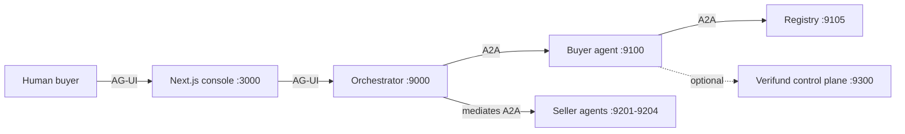
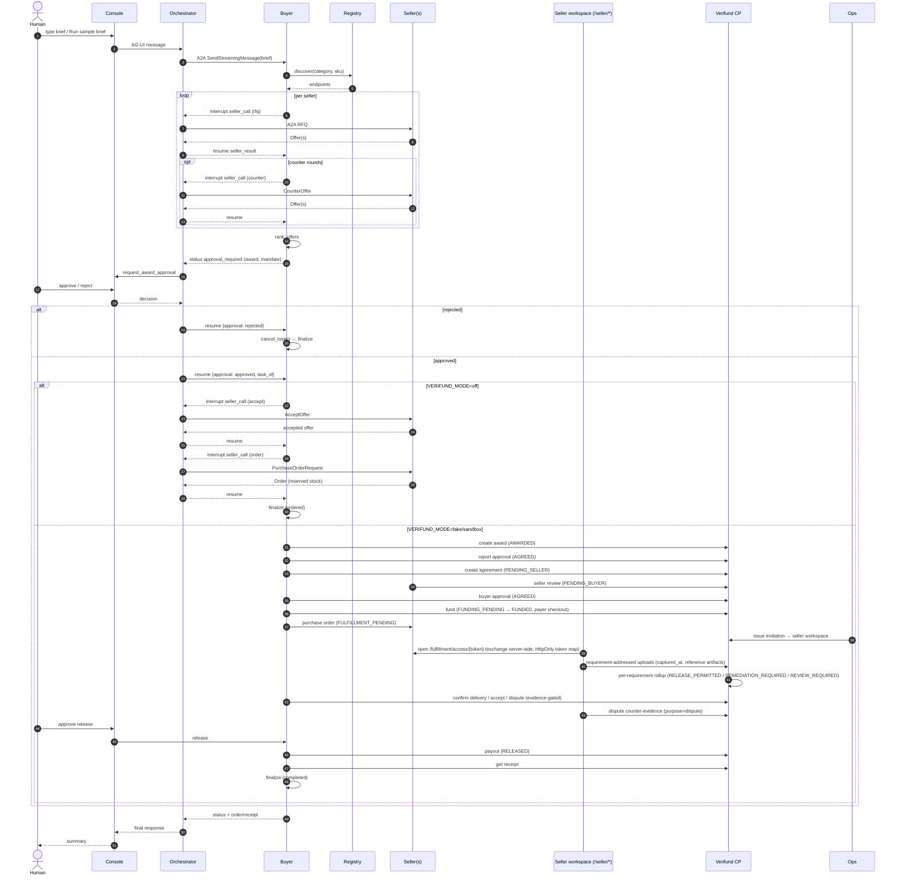

# MarketMesh End-to-End Workflow

This document traces the complete MarketMesh workflow from the moment a human clicks
**"Ask agent to negotiate"** in the console all the way through to the seller receiving
a payout and the transaction closing with a signed receipt. It covers both the default
off-mode commerce path and the optional Verifund settlement path, and shows where they
diverge.

> Related: [`README.md`](../README.md), [`docs/architecture.md`](architecture.md),
> [`docs/verifund-paypal-sandbox.md`](verifund-paypal-sandbox.md).

---

## 1. Overview

MarketMesh is a multi-agent commerce exchange. A human buyer describes a sourcing need
in the console. An orchestrator agent coordinates a buyer agent, which discovers
independent seller agents through a registry, negotiates structured offers over A2A,
ranks them deterministically, and **stops for human approval before any order is created**.
After approval the flow either (a) places a purchase order with the winning seller
(off-mode), or (b) runs a full held-funds settlement lifecycle ending in a payout and
signed receipt (Verifund mode).



---

## 2. Actors and service boundaries

| Service | Port | Owns | Does not own |
|---|---|---|---|
| Console | 3000 | UI state, CopilotKit chat, approval presentation, trace/registry proxies | Prices, mandate validation, orders |
| Orchestrator | 9000 | AG-UI entrypoint, mediated buyer/seller coordination, seller-call resumption | Mandate validation, ranking, stock, order IDs |
| Buyer agent | 9100 | Mandate, discovery, negotiation orchestration, ranking, approval interrupt, purchase orders | Seller stock, seller cost floors |
| Registry | 9105 | Agent Card index, categories, card hashes, health | Negotiation, trust decisions, orders |
| Seller agents | 9201-9204 | Catalog policy, quote generation, negotiation choices, stock, reservations, order IDs | Buyer budget, ranking, human approval |
| Verifund control plane | 9300 | Settlement state, held-funds ledger, evidence records, PayPal calls, receipts, audit | Mandate, ranking, seller stock |

Protocols: **AG-UI** (human-facing, streaming, interrupts) between browser/console/orchestrator;
**A2A 1.x JSON-RPC over HTTP** (SSE) between orchestrator/buyer/sellers. The console never
speaks A2A and never receives seller bearer tokens.

---

## 3. Entry point: "Ask agent to negotiate"

1. The human enters a sourcing brief in the CopilotKit chat rail (or clicks **Run sample brief**).
2. The console sends the brief over AG-UI to the orchestrator.
3. The orchestrator forwards it to the Buyer A2A agent as a new sourcing run, carrying the
   human's natural-language brief.
4. The buyer starts its LangGraph graph at `interpret_brief`, with `thread_id = run_id`.

The buyer graph (high level):

```
interpret_brief → discover_sellers → plan_sourcing → prepare_mediated
  → select_next_seller ↔ process_seller (one seller at a time, mediated)
  → rank_offers → await_approval (interrupt)
  → place_order ──┐
  └ reject → cancel_losers → finalize
```

---

## 4. Phase 1 — Sourcing and negotiation

### 4.1 Interpret brief (`interpret_brief`)

- Extracts the latest `HumanMessage`, parses it into a `Mandate` (product, quantity, budget,
  deadline, warranty, returns, preferences) using the planner (LLM or scripted fallback).
- Normalizes the mandate against the `Mandate` schema; a regex fallback exists if parsing fails.
- Guardrail: the RFQ must never contain `max_total_cents` (budget) in dollars or cents.
- Persists `stage = "brief_ready"` and the mandate.

### 4.2 Discover sellers (`discover_sellers`)

- Calls the registry for sellers matching `mandate.category` / `mandate.product_sku`.
- Independently validates each Agent Card (`validate_agent_card`); invalid cards are skipped and
  recorded as `card_rejected` trace frames.
- If no validated sellers remain, the run ends in `failed` (`no_validated_sellers`).

### 4.3 Plan sourcing (`plan_sourcing`)

- Composes a budget-safe RFQ message (`compose_rfq`), falling back to a deterministic template.
- Persists `stage = "sourcing_planned"`.

### 4.4 Negotiate per seller (`_mediated_process_seller`)

For each seller (mediated, one at a time):

1. **RFQ** — buyer builds an `RFQ` (request id `rfq-{run_id}-{seller}-mediated`) and pauses with
   an interrupt `kind="rfq"`. The orchestrator's `mediate_seller_call` forwards it to the seller.
   The seller quotes at policy price and returns structured `Offer`(s). The buyer revalidates each
   offer: seller ID, request ID, SKU, recomputed line-item and total arithmetic must match.
2. **Counter rounds** (up to 2) — buyer computes allowed counter targets via
   `counter_targets(unit_price, max_total_cents, quantity)` and sends a `CounterOffer`. The seller
   chooses an allowed concession or accepts/rejects. New offers are revalidated.
3. **Final offer** — the last offer becomes the seller's final offer; a `NegotiationRecord` is
   appended with status `final`/`rejected`/`error`.

Each seller pause is resumed by the orchestrator with the seller's `seller_result` (offers, orders,
task/context ids, and — after the fix described in the prior analysis — any commerce error).

### 4.5 Rank offers (`rank_offers`)

- Deduplicates offers by seller, then runs `rank_eligible_offers` (deterministic scoring in
  `commerce_core`).
- Hard-constraint failures are recorded per seller.
- If no offer satisfies the mandate → `stage = "no_award"`, run ends, **no approval is opened**.
- Otherwise builds an `AwardPackage` (winner, alternatives, scores, savings, mandate checks) and an
  award explanation. Persists `stage = "awaiting_approval"` with the award.

### 4.6 Human approval gate (`await_approval`) — interrupt

- The interrupt payload contains the award, mandate, a message, and a response schema requiring
  `approved`, `approved_by`, `note`.
- The orchestrator calls the frontend `request_award_approval` tool with the exact values and waits.
- On resume:
  - `approved: true` + non-empty `approved_by` → in `VERIFUND_MODE=off`, creates an `ApprovalReceipt`
    and proceeds to `place_order`; in settlement mode, the buyer resumes at
    `create_settlement_award` with the canonical agreement flow.
  - `approved: false` or the AG-UI cancellation sentinel → `cancel_losers`.
- The seller never sees an approval decision that did not come through this graph resume.

---

## 5. Phase 2 — after approval

The paths diverge based on `VERIFUND_MODE`.

### 5.1 Path A — off-mode (default): place order

Node: `_mediated_place_order` (`place_order`).

1. Re-verifies approval; otherwise cancels losers.
2. Builds `ApprovalReceipt` (approval_id, approved_by, approved_at, note).
3. Builds `PurchaseOrderRequest` (request_id, run_id, offer_id, seller_id, quantity, shipping
   address, approval receipt, idempotency key `{run_id}:{offer_id}`, expected total).
4. Builds `AcceptOffer` (offer_id, round, accepted total, accepted_by_buyer_task).
5. **Accept pause** (`kind="accept"`) — seller persists the accepted offer (`status = ACCEPTED`).
   On seller error → `stage = "order_failed"`.
6. **Order pause** (`kind="order"`) — seller validates, reserves stock in a single SQLite
   transaction, creates the order (idempotent: duplicate PO returns the original order). On
   missing order → `order_failed` (expired offer, out of stock, validation mismatch, etc.).
7. Updates negotiations: winner → `status: "accepted"` with final offer; all others → `cancelled`.
8. Persists `stage = "ordered"` with the order; trace `order_confirmed`.
9. `finalize` emits: *"Order {id} is confirmed with {seller}. Tracking: {tracking}."*

Rejection path (`cancel_losers`): all negotiations → `cancelled`, `stage = "rejected"`,
`order = None`, trace `award_rejected`; finalize emits *"No order was placed."*

### 5.2 Path B — Verifund settlement: award → agreement → funding → order → evidence → release → payout

Triggered when `VERIFUND_MODE != off`. The Verifund control-plane state machine
(design spec §4):

```
AWARDED → AGREED → FUNDING_PENDING → FUNDED → FULFILLMENT_PENDING
  → VERIFICATION_PENDING → (REMEDIATION_REQUIRED ↔ VERIFICATION_PENDING)
  → RELEASE_PERMITTED → PAYOUT_PENDING → RELEASED
  → REVIEW_REQUIRED (any REVIEW; reversible to REMEDIATION/VERIFICATION)
  → DISPUTE_OPEN (valid buyer dispute; exits only by reviewer decision or ladder cap)
  → REFUNDED (terminal, after a successful refund)
```

with `VERIFICATION_PENDING → PAYOUT_PENDING` and `RELEASE_PERMITTED →
PAYOUT_PENDING` on buyer `ACCEPT` (early acceptance, final), and
`DISPUTE_OPEN → RELEASE_PERMITTED` (dismissed/settled), `DISPUTE_OPEN →
REMEDIATION_REQUIRED` (upheld repair/replacement), `DISPUTE_OPEN → REFUNDED`
(upheld refund). `CANCELED` and `FAILED` remain terminal. Policy computes
`RELEASE_PERMITTED`; a reviewer performs the audited release, narrowed so
only a `manual_flag` review reason is overridable (all verification failures
are non-overridable).

After the human award approval, the buyer graph produces the award decision and the bilateral
agreement outcome, and the rest of the settlement lifecycle is owned by the Verifund agent through
the orchestrator. Agreement consent is split into three separate surfaces:

1. **Seller review** — the Verifund graph runs `create_agreement` (goods v1, deterministic, no LLM)
   then `await_seller_review`. The seller agent verifies the offer hash, the agreement digest, the
   version chain, and its configured mandate; it returns `ACCEPTED`, `REJECTED`, `OPERATOR_REQUIRED`,
   or `CHANGES_REQUESTED`. `OPERATOR_REQUIRED` keeps the agreement in `PENDING_SELLER` for a human
   seller operator. On accept, the control plane moves the agreement to `PENDING_BUYER` and issues a
   single-use, token-bound buyer approval token.
2. **Buyer approval** (`buyer_approval_required`) — non-blocking for the buyer graph; the console
   review page (`/agreements/{id}`) shows the rendered agreement, version, digest, seller decision,
   and the buyer's non-binding precheck. The buyer approves/rejects/requests changes through a
   server-issued token; both parties must `ACCEPT` the same current version and digest for the
   agreement to reach `AGREED`. `AGREED` is terminal for consent; funding never mutates the
   agreement.
3. **Change requests** — a change request never mutates an existing version; it creates version
   `N+1` with a new digest and requires two fresh acceptances. One open change request per agreement.
4. **Funding approval** (`verifund_fund`) — only possible once `status = AGREED` with matching
   version/digest and both acceptances binding that version/digest; the transaction must point at
   the agreement. The Verifund lifecycle returns `approval_required` with
   `hitl.tool="request_verifund_funding_approval"`; the orchestrator passes `hitl.args` to the
   frontend unchanged, then resumes the funding checkpoint with the structured human decision.
   Rejection → transaction `CANCELED`.
5. **Fund** — `FUNDING_PENDING` until the payer completes the PayPal checkout; `verifund_evidence_review`
   waits for funding at `FUNDED`, then places the purchase order with the seller and reports it
   (`FULFILLMENT_PENDING`).
6. **Evidence / verification** — after `FULFILLMENT_PENDING`, the seller
   submits requirement-addressed evidence from the seller workspace
   (`/seller/*`, invitation exchange via
   `POST /ops/transactions/{id}/issue-invitation` →
   `/fulfillment/access/{token}`; tokens stay in an HttpOnly cookie). Each
   upload carries `requirement_id`, optional `captured_at`, and either a
   file (honoring `accepted_formats`) or — for `source=reference`
   requirements (e.g. shipping) — a `reference` + `reference_type=tracking|url`.
   Submissions accumulate per attempt; a seller declaration closes an attempt.
   The control plane evaluates per requirement and rolls up; partial evidence
   never releases. Outcome `RELEASE_PERMITTED`, `REMEDIATION_REQUIRED`
   (fixable failure), or `REVIEW_REQUIRED` (extraction/human review).
7. **Delivery, acceptance, and disputes** — the buyer confirms delivery
   (`CONFIRM_DELIVERY`, bounded `confirmed_at`) and may `ACCEPT`
   (early-final transition to `PAYOUT_PENDING`). A valid buyer dispute
   (evidence-gated, artifact + claim required) opens `DISPUTE_OPEN` and
   holds funds; the seller answers with counter-evidence
   (`purpose=dispute`, ignored by rollup). Reviewer decisions dismiss,
   uphold (remedy `REMEDIATION_REQUIRED` or first-class refund to
   `REFUNDED`), or escalate; `resolve_system_failure` and
   `return_to_remediation` cover ops recovery. Buyer token is ops-issued
   (`txn:buy`, bound to `buyer_id` + `transaction_id`).
8. **Release** — reviewer approves the audited release (only `manual_flag`
   is overridable); payout → `RELEASED` (or `REVIEW_REQUIRED` on payout failure).
9. **Receipt** — fetch the signed receipt; stage `completed`.

The Verifund lifecycle task (`VerifundLifecycle`) owns funding, purchase order, evidence, release, and
receipt steps; the buyer agent only produces the award decision and the bilateral agreement outcome.

The Transaction Room in the console shows synchronized funding, evidence, verification, payout,
cancellation, and signed receipt details.

---

## 6. Orchestrator mediation protocol

The buyer never speaks A2A to sellers directly. Every seller pause is mediated:

1. Buyer emits interrupt `reason="seller_call"` with `seller_id`, `card_url`, `request`,
   `seller_task_id`, `seller_context_id`.
2. Orchestrator calls `mediate_seller_call(buyer_task_id, seller_card_url, seller_request, ...)`.
3. Orchestrator resolves the seller bearer token (by seller ID, never from the buyer), sends the
   A2A message to the seller, collects offers/orders (and, after the fix, commerce errors).
4. Orchestrator resumes the buyer with `{"seller_result": ..., "task_id": buyer_task_id}`.
5. If the buyer requests another seller call, mediate again; do not send a separate buyer message.

Human award approval protocol (orchestrator, §5 of its instruction):

- On `status: "approval_required"`, extract exact `task_id`, `message`, `award`, `mandate`.
- Call frontend `request_award_approval` tool; wait for its result.
- After approval, resume the buyer with the decision **nested** under `approval` plus the original
  `task_id`:
  `{"approval": {"approved": true, "approved_by": "...", "note": "..."}, "task_id": "..."}`.
- Never lift fields to top level, rename keys, or wrap in prose. Never infer approval.

Verifund settlement protocol (orchestrator, §6 of its instruction):

- After the buyer approval resumes the sourcing run, the buyer graph pauses with
  `reason="agreement_create_required"`. Call `verifund_create_agreement` with the exact run,
  task/context, flat award, seller card URL, and seller ID; it mediates the buyer review, seller
  review, and the buyer's recorded seller decision.
- When Verifund returns `approval_required` with `hitl.tool="request_verifund_funding_approval"`, pass
  `hitl.args` to the frontend unchanged and resume with `verifund_fund`.
- After funding, call `verifund_evidence_review` to place the purchase order and poll funding/evidence.
- When Verifund returns `approval_required` with `hitl.tool="request_verifund_release_approval"`, pass
  `hitl.args` unchanged and resume with `verifund_release`; then call `verifund_receipt` for the signed
  receipt.

---

## 7. Failure handling

| Failure | Where handled | Outcome |
|---|---|---|
| Unavailable seller | `discover_sellers` | Others still fan out; failed seller → error negotiation record, run continues |
| Invalid Agent Card | `discover_sellers` | Skipped, reason recorded |
| Protocol violation / bad offer | `_trusted_offer` | Recorded against that seller; others continue |
| No eligible offer | `rank_offers` | `no_award`, no approval opened |
| Duplicate order | `OrderService.create_order` | Returns original order, no second reservation |
| Expired offer | `OrderService._validate` | `offer_expired` (non-retryable) → `order_failed` |
| Stock race | `OrderService.create_order` | `out_of_stock` (retryable) → `order_failed` |
| Approval rejected / sentinel | `approval_route` | `cancel_losers`, no order |
| Trace failure | buyer trace | UI shows error; commerce run continues |
| Funding mismatch / late capture (Verifund) | control plane | Stays `VERIFICATION_PENDING`; never releases on partial evidence |
| Payout failure (Verifund) | control plane | → `REVIEW_REQUIRED`; reviewer retries or resolves in PayPal |

---

## 8. Data ownership

| Data | Store |
|---|---|
| Buyer run summary + A2A trace frames | `data/buyer.db` |
| LangGraph checkpoints + interrupt state | `data/buyer-checkpoints.db` |
| Orchestrator ADK session state | In memory (not persisted) |
| Agent Card index | `data/registry.db` |
| Seller policy state, offers, stock, orders | `data/<seller>.db` |
| Verifund transactions, ledger, receipts | `data/verifund.db` |
| Evidence blobs | `data/evidence/<sha256>` |

No service shares an ORM session or transaction with another. Seller tokens and the buyer's
copy of the seller token live in `run_secrets` / `settlement_tokens` and never enter graph
state, traces, logs, or AG-UI.

---

## 9. End-to-end sequence (Mermaid)



Seller workspace details (routes, invitation flow, status vocabulary) are in
[`docs/seller-fulfillment-workspace.md`](seller-fulfillment-workspace.md).

    end
  end
  Buyer-->>Orch: status + order/receipt
  Orch-->>Console: final response
  Console-->>Human: summary
```

---

## 10. Key invariants

- Approval occurs **before** any `AcceptOffer` or `PurchaseOrderRequest` is sent.
- The RFQ never contains `max_total_cents`; a guardrail rejects any RFQ text that leaks the budget.
- Offers are revalidated (seller ID, request ID, SKU, arithmetic) before ranking.
- Ranking and hard-constraint filtering are deterministic functions in `commerce_core` (not LLM).
- Stock reservation is transactional; duplicate POs return the original order.
- Verifund funding mismatches, ledger inconsistencies, and late captures cannot be overridden and are
  resolved in PayPal; partial evidence never releases.
- No service shares a database transaction with another.
- Agreement consent is split into three separate surfaces: seller acceptance, buyer agreement approval,
  and funding authorization. `AGREED` requires two `ACCEPT` decisions on the same current version and
  digest; funding is impossible unless `status = AGREED`, version/digest match, both decisions bind
  that version/digest, and the transaction points at the agreement (`can_start_funding`).
- A change request never mutates an existing version; it creates version `N+1` with a new digest and
  requires two fresh acceptances. Old versions, decisions, and change requests are never deleted.
- One open change request per agreement.
- Approval tokens are single-use, never stored in plaintext, and never logged or placed in chat.
- Seller agents may auto-accept only inside their configured mandate; otherwise `OPERATOR_REQUIRED`.

---

*Generated from the MarketMesh codebase. Keep this document in sync with `docs/architecture.md` and the
buyer/seller/Verifund graphs when changing flow.*